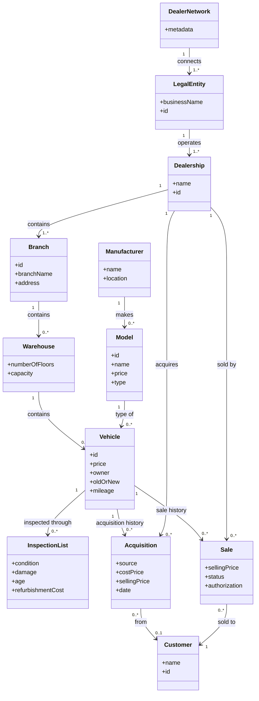
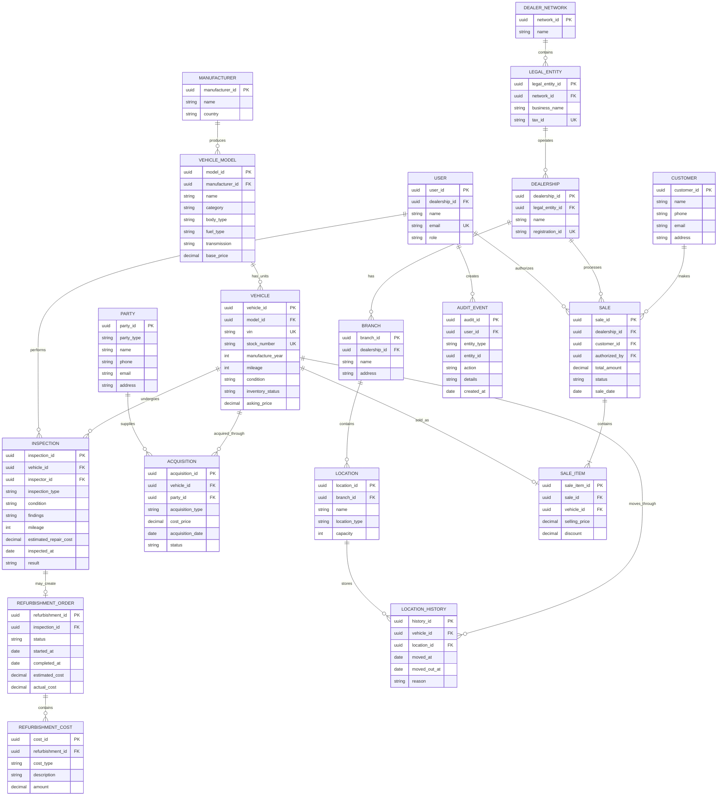
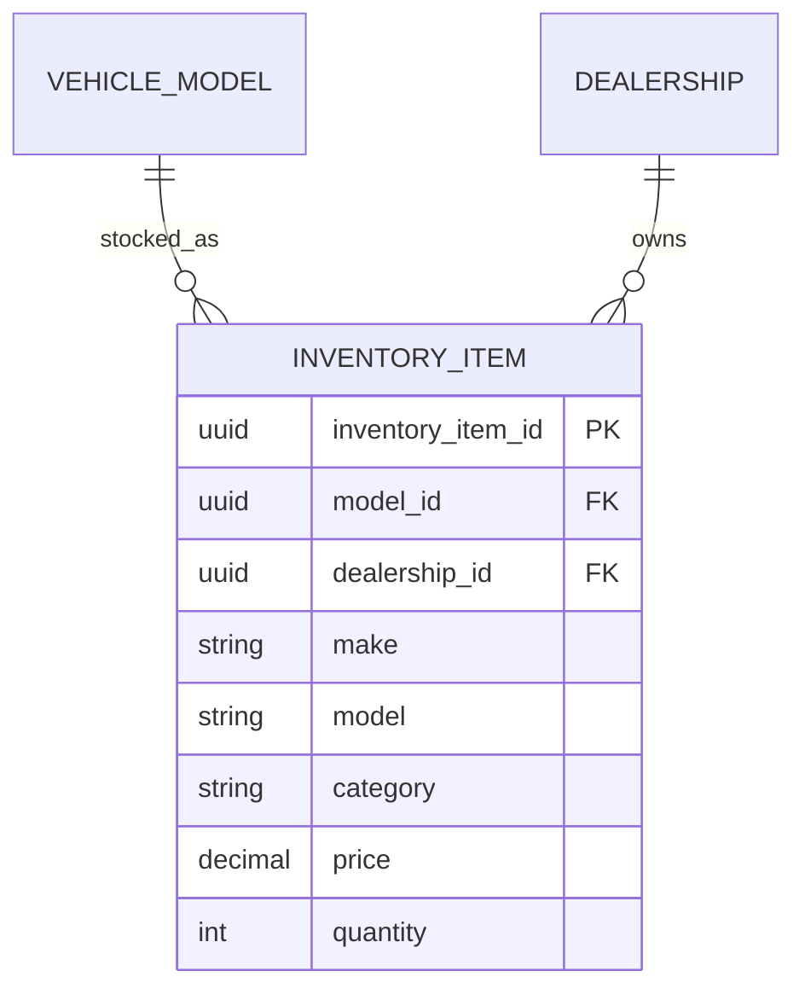
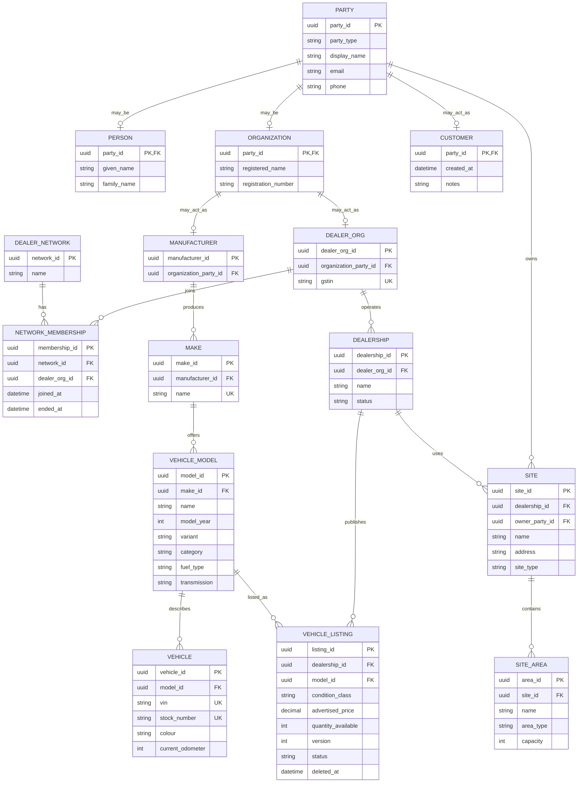
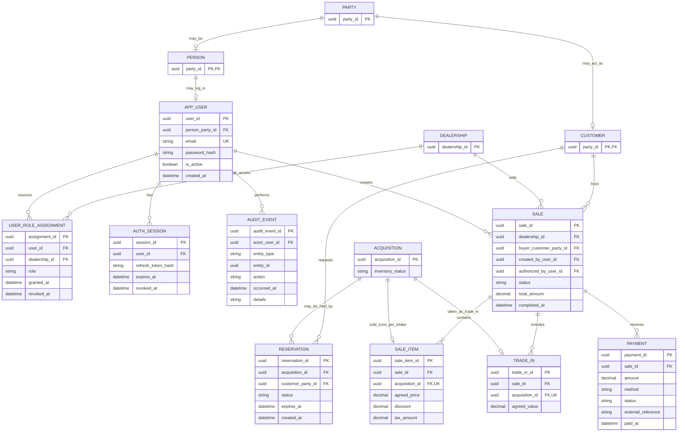

# Plan application backend

> i need to make a backent for an application , tell mw all the things that are necessary in it . and explain them too.

A backend is the part of an application that runs behind the scenes: it stores data, applies business rules, protects users, and serves APIs to the frontend/mobile app.

Here’s what a solid backend usually needs:

1. **Application/API layer**
   Endpoints that the frontend calls, such as:
   - `POST /auth/login`
   - `GET /products`
   - `POST /orders`

   Most modern backends use REST APIs; GraphQL is useful when clients need highly flexible data queries.

2. **Programming language and framework**
   Pick one ecosystem suited to your team and project:
   - JavaScript/TypeScript: Node.js, Express, NestJS
   - Python: Django, FastAPI
   - Java: Spring Boot
   - C#: ASP.NET Core
   - Go: Gin, Fiber

   The framework gives you routing, request handling, validation, middleware, and conventions.

3. **Database**
   Persistent storage for users, products, orders, posts, etc.
   - Relational: PostgreSQL or MySQL — best default for structured application data.
   - NoSQL: MongoDB — useful for flexible document-shaped data.
   - Cache: Redis — fast temporary storage for sessions, rate limits, and frequently requested data.

   Design tables/collections carefully and add indexes for common searches.

4. **Authentication and authorization**
   - Authentication answers: “Who is this user?”
   - Authorization answers: “What is this user allowed to do?”

   Common setup: secure password hashing (Argon2 or bcrypt), JWT/session tokens, refresh tokens, roles such as `admin`, `staff`, and `user`.

5. **Business logic**
   The rules that make your application unique—for example:
   - calculating order totals and taxes
   - ensuring a booked time slot is available
   - applying coupons
   - preventing unauthorized edits

   Keep this separate from API route code so it stays testable and maintainable.

6. **Validation and error handling**
   Never trust browser or mobile-app input. Validate:
   - required fields
   - data types
   - allowed values
   - length and format
   - ownership/permission

   Return clear, consistent errors without exposing internal details.

7. **Security**
   Essential protections include:
   - HTTPS
   - parameterized database queries / ORM protection against SQL injection
   - secure password hashing
   - rate limiting for login and public endpoints
   - CORS configuration
   - security headers
   - input sanitization where user content is displayed
   - secrets stored in environment variables, never in source control

8. **File storage, if needed**
   Store uploads such as profile pictures, PDFs, and videos in object storage—not directly in the database. Examples: AWS S3, Cloudflare R2, or Google Cloud Storage. Store only file URLs and metadata in the database.

9. **Background jobs and queues**
   Some work should not delay an API response:
   - sending emails
   - image processing
   - report generation
   - notifications
   - payment/webhook retries

   Use a queue such as BullMQ, RabbitMQ, SQS, or a managed equivalent.

10. **External-service integrations**
   Often includes:
   - payments: Stripe/Razorpay
   - email: Resend/SendGrid
   - SMS/WhatsApp
   - OAuth login: Google, GitHub, Apple
   - maps, analytics, notifications

   Verify webhook signatures and handle retries safely.

11. **Logging, monitoring, and alerts**
   You need to know when something fails in production.
   - structured logs
   - error tracking, e.g. Sentry
   - uptime and performance monitoring
   - alerts for major failures

12. **Testing**
   At minimum:
   - unit tests for business logic
   - integration tests for APIs and database behavior
   - authentication and permission tests
   - end-to-end tests for critical user flows

13. **Documentation**
   Document:
   - API endpoints and request/response formats
   - authentication method
   - environment variables
   - local setup instructions
   - database migrations
   - deployment process

   Swagger/OpenAPI is excellent for API documentation.

14. **Deployment and infrastructure**
   You need a production environment with:
   - hosting: Render, Railway, Fly.io, AWS, GCP, Azure, etc.
   - managed database
   - environment variables/secrets
   - domain and HTTPS
   - automated deployments from GitHub
   - database backups and migration strategy

15. **Version control and CI/CD**
   Use Git and GitHub/GitLab. A CI pipeline should run linting and tests on every pull request, then deploy approved changes automatically.

A practical default stack for many new applications is:

- **TypeScript + Node.js + NestJS/Express**
- **PostgreSQL**
- **Prisma or Drizzle ORM**
- **Redis**
- **JWT or secure cookie sessions**
- **S3/R2 for uploads**
- **Stripe/Razorpay for payments**
- **Docker**
- **GitHub Actions**
- **Render/Railway/Fly.io or AWS for deployment**
- **Sentry for error tracking**

The exact backend design depends on what you’re building—an e-commerce app, social app, booking system, SaaS dashboard, and so on have different priorities.

> what is the typical practive or protocol how to start building a backend?

A typical backend workflow is:

1. Define the product requirements
   Write down what users can do: sign up, log in, create posts, place orders, upload files, pay, etc. These become backend features.

2. Define data and user roles
   List the main entities and their relationships.

   Example for a store:

   ```text
   User → places → Order
   Order → contains → OrderItems
   OrderItem → refers to → Product
   ```

   Also define roles: customer, admin, staff—and what each can access.

3. Design the API contract
   Before coding, define endpoints, inputs, outputs, and errors.

   ```text
   POST /auth/register
   POST /auth/login
   GET  /products
   POST /orders
   GET  /orders/:id
   ```

   This prevents the frontend and backend from becoming disconnected. Use OpenAPI/Swagger where possible.

4. Choose the stack
   Choose based on your team, hosting, and needs. A straightforward beginner-friendly production stack:

   ```text
   Node.js + TypeScript + Express/NestJS
   PostgreSQL + Prisma
   JWT or cookie-based sessions
   Docker
   ```

5. Set up the project foundation
   Create the repository and configure:
   - formatter and linter
   - environment variables
   - folder structure
   - development database
   - logging
   - centralized error handling
   - API versioning, such as `/api/v1/...`

6. Design and create the database
   Create schemas/models, add constraints, relationships, indexes, and migrations. Never manually change the production database without migrations.

7. Implement authentication first
   Build registration, login, logout, password hashing, token/session handling, role checks, and password reset. Most other endpoints rely on knowing who the user is.

8. Build features vertically
   Complete one usable feature end-to-end before starting the next:

   ```text
   database model
   → validation
   → service/business logic
   → API endpoint
   → authorization
   → tests
   → documentation
   ```

   For example, completely finish “create and view products” before moving to cart and checkout.

9. Test continuously
   Test normal cases, invalid inputs, unauthorized access, duplicate data, edge cases, and database failures. Add automated tests for important business rules.

10. Secure and optimize
   Add rate limits, CORS rules, security headers, input validation, safe database queries, and protection for secrets. Add indexes and caching only after measuring slow areas.

11. Document and deploy early
   Deploy a development/staging version early—not just at the end. Add API documentation, database backups, error tracking, health checks, and CI/CD.

12. Monitor and improve
   Watch errors, slow API requests, database performance, and user behavior. Fix recurring issues and improve based on real usage.

The short version:

```text
Requirements
→ Data model
→ API design
→ Project setup
→ Database migrations
→ Authentication
→ Feature-by-feature implementation
→ Tests and security
→ Deployment
→ Monitoring
```

The most common mistake is immediately writing endpoints without first defining the data model, permissions, and API contract.

> as i am building an inventory system and would require multiple test also to be done over the application , a full fledged application industrial production level app , so tell me the exact tech stack .telling what i will be doing and which tech stack is for what ,make it into a table exhaustive.

<details><summary>4 previous messages</summary>

> I’ll check the current project structure and then map a concrete production stack to each part of the inventory system, including testing and deployment. I’ll call out where a component is needed from day one versus when scale justifies it.
>
> <details><summary>Ran 2 commands, searched the web</summary>
>
> Searched the web for `site:docs.nestjs.com techniques validation testing OpenAPI NestJS ...`
>
> - Ran `git status --short`
>
> - Ran `rg --files -g '!node_modules' -g '!dist' -g '!build' | Select-Object -First 80`
>
> </details>
>
> There’s no existing project or Git repository in the current folder, so I’ll treat this as a fresh build. For inventory, the design decision that matters most is how stock changes are recorded: every receipt, sale, return, reservation, and adjustment needs a traceable transaction. That drives the database and test strategy.
>
> <details><summary>Searched the web</summary>
>
> Searched the web for `site:docs.nestjs.com fundamentals testing OpenAPI validation NestJS ...`
>
> Searched the web for `site:docs.aws.amazon.com cognito user pools JWT OIDC API authorization groups ...`
>
> Searched the web for `site:playwright.dev/docs/intro Playwright end-to-end test cross browser ...`
>
> </details>
</details>

For a **web-based, multi-warehouse inventory system** with staff accounts, barcode scanning, purchasing, stock transfers, and reports, I would build a **modular monolith**: one backend application with clearly separated modules, plus a background worker. This gives you production-grade controls without the operational burden of microservices.

The most important design rule is: **record every stock change as a transaction**. A number such as “42 units available” is useful for display, but the system must also know *why* it became 42.

### Recommended tech stack

| Area | Exact choice | What you will use it for |
|---|---|---|
| Backend language | **TypeScript on Node.js LTS** | Implement APIs and business rules with type checking. Pin the runtime version in the project and Docker image. |
| Backend framework | **NestJS** | Organize code into modules such as Products, Warehouses, Purchasing, Stock, Transfers, and Reports. Its testing and API documentation support suit a larger application. [NestJS testing docs](https://docs.nestjs.com/fundamentals/testing) |
| API style | **REST + JSON** | Expose predictable endpoints for the web app, scanners, and future integrations. |
| API documentation | **OpenAPI via `@nestjs/swagger`** | Specify request fields, responses, errors, and authentication; generate an API reference for frontend and QA work. |
| Input validation | **NestJS validation pipes + `class-validator`** | Reject invalid quantities, missing fields, malformed IDs, and unsupported status changes at the API boundary. |
| Primary database | **PostgreSQL** | Store products, locations, users, orders, stock movements, and audit records. Its transactions and locking are critical when multiple people change the same stock concurrently. [PostgreSQL transaction documentation](https://www.postgresql.org/docs/current/transaction-iso.html) |
| Database access | **Drizzle ORM + `pg`** | Write typed database queries while retaining direct SQL control for complicated stock operations. [Drizzle transactions](https://orm.drizzle.team/docs/transactions) |
| Schema changes | **Drizzle Kit SQL migrations** | Version and review database changes alongside code; apply them during deployment. [Drizzle migrations](https://orm.drizzle.team/docs/migrations) |
| Authentication | **Amazon Cognito User Pools using OIDC** | Handle staff sign-in, password recovery, and MFA without building password infrastructure yourself. The backend validates access tokens. [Cognito documentation](https://docs.aws.amazon.com/cognito/latest/developerguide/cognito-user-pools.html) |
| Authorization | **NestJS guards + roles and warehouse permissions stored in PostgreSQL** | Enforce rules such as “receiver can confirm delivery at Warehouse A” and “manager can approve adjustments.” Check permissions on every relevant API request. |
| Background tasks | **Amazon SQS + a NestJS worker** | Process exports, alerts, emails, and integration retries outside the request path. Stock updates themselves stay in PostgreSQL transactions. |
| File storage | **Amazon S3** | Store product images, invoices, import files, and generated reports; keep metadata and permissions in PostgreSQL. |
| Web frontend | **React + TypeScript + Vite** | Build the staff dashboard, receiving screens, transfer forms, and reports. |
| Frontend data/forms | **TanStack Query + React Hook Form + Zod** | Fetch and refresh API data, manage forms, and validate entries for a good user experience. Backend validation still remains authoritative. |
| UI components | **MUI + TanStack Table** | Build consistent forms, dialogs, filters, and large inventory tables without designing every control from scratch. |
| Local development | **Docker Compose** | Run PostgreSQL, the API, and the worker consistently on developer machines. |
| Container build | **Docker** | Package the API and worker into reproducible deployable images. |
| Production hosting | **AWS ECS on Fargate + Application Load Balancer** | Run the API and worker as separate container services; route HTTPS traffic to the API. [AWS ECS load balancing](https://docs.aws.amazon.com/AmazonECS/latest/developerguide/service-load-balancing.html) |
| Managed database | **Amazon RDS for PostgreSQL** | Host PostgreSQL with managed backups and point-in-time recovery. Test restoration periodically; having backups alone is insufficient. [AWS RDS backup documentation](https://docs.aws.amazon.com/AmazonRDS/latest/gettingstartedguide/managing-backup-restore.html) |
| Secrets | **AWS Secrets Manager** | Store database credentials and integration keys outside source code and container images. |
| Infrastructure definition | **AWS CDK in TypeScript** | Keep the ECS, RDS, S3, SQS, networking, and permissions configuration reviewable in Git. |
| CI/CD | **GitHub Actions + Amazon ECR** | On pull requests, run checks and tests; on approved releases, build images, publish them, run migrations, and deploy. |
| Logs and alerts | **Structured JSON logs + Amazon CloudWatch** | Investigate failures by request ID, alert on errors, queue backlog, and unhealthy services. Never log passwords or sensitive tokens. |
| Tracing | **OpenTelemetry** | Follow a request through the API, database, and worker when investigating slow or failed operations. [OpenTelemetry JavaScript docs](https://opentelemetry.io/docs/languages/js/) |
| Code quality | **ESLint + Prettier + TypeScript strict mode** | Catch common mistakes and keep the code consistent. |

### Testing stack

| Test type | Tool | What you will test |
|---|---|---|
| Unit tests | **Vitest** | Pure rules: available stock calculation, reorder thresholds, status transitions, costing rules, and permission decisions. |
| Database integration tests | **Vitest + Testcontainers PostgreSQL** | Real SQL constraints, migrations, transactions, locking, and rollback behavior against PostgreSQL. [Testcontainers guide](https://testcontainers.com/guides/getting-started-with-testcontainers-for-nodejs/) |
| API tests | **NestJS test utilities + Supertest** | Endpoint responses, validation errors, authentication, and role or warehouse access. [NestJS testing docs](https://docs.nestjs.com/fundamentals/testing) |
| Browser end-to-end tests | **Playwright** | Complete workflows such as receiving a purchase order, transferring stock, counting stock, and viewing the resulting report. [Playwright docs](https://playwright.dev/docs/intro) |
| Performance tests | **k6** | Measure search, reporting, and simultaneous stock operations under your expected workload. Set thresholds from actual business targets. [k6 docs](https://grafana.com/docs/k6/latest/) |
| Security checks | **Dependency scanning, CodeQL, and a staging security review** | Catch vulnerable dependencies and code issues; manually verify that staff cannot access another warehouse’s records or alter stock through unauthorized endpoints. |
| Recovery tests | **Scheduled restore exercise** | Restore an RDS backup to a separate environment and confirm data and application behavior. |

For inventory specifically, I would make these tests release critical: two users issuing the last unit at the same time; retrying the same request; a transfer that fails halfway; receiving more or less than ordered; reversing a mistaken adjustment; and ensuring a user assigned to Warehouse A cannot edit Warehouse B. PostgreSQL supports the transaction controls needed here, but your application must use them correctly. [PostgreSQL transaction isolation](https://www.postgresql.org/docs/current/transaction-iso.html)

### Core modules you will build

| Module | Main responsibility |
|---|---|
| Products | SKU, barcode, unit of measure, categories, variants, and status |
| Warehouses and locations | Warehouses, shelves/bins, and who may operate in each |
| Stock ledger | Immutable records of receipts, issues, transfers, returns, and adjustments |
| Stock balances | Fast current quantities derived and updated consistently with ledger entries |
| Reservations | Hold stock for orders without treating it as physically removed |
| Purchasing and receiving | Suppliers, purchase orders, partial receipts, discrepancies |
| Transfers | Request, dispatch, receive, and reconcile movement between locations |
| Stock counts | Cycle counts, variance review, approvals, and adjustment entries |
| Audit | Actor, timestamp, reason, before/after context, and correlation ID |
| Reports and alerts | Low stock, movement history, valuation, discrepancies, and exports |

A sensible build order is **products and locations → stock ledger and balances → receiving and issuing → transfers and counts → reporting and integrations**. Add authentication, authorization, migrations, and automated tests from the beginning.

This is a specific recommendation, with one important assumption: users have reliable connectivity. If warehouse scanners must keep working offline, the client, sync protocol, and conflict handling need additional design before implementation.

> check out this UML diagram is this okay?? is there anything that needs modification or is incorrect or is diverging from the concept of building an application for the car delearship inventory. NOTE: here the dealership deals with both new and the dealing of old cars / refurbished ones too .
>
> User context
>
> Images:
> - `C:/Users/shikh/AppData/Local/Temp/codex-clipboard-52684fa8-256f-4052-899d-e12c31176c9d.png`

<details><summary>2 previous messages</summary>

> I’ll read the entities and relationships in the diagram, then check whether they support the full vehicle lifecycle: new-car intake, used-car acquisition, inspection/refurbishment, transfers, and sale. I’ll distinguish unclear handwriting from definite modeling issues.
>
> Viewed an image
</details>

Yes—the diagram is a good **first conceptual sketch**. It identifies the dealership structure, manufacturers, models, individual vehicles, acquisitions, customers, inspections, and sales. But I would revise it before using it as the database design. The main gap is that a car can pass through the dealership more than once, and a used car has costs and history that develop over time.

I’m reading `CP` as cost price and `SP` as selling price; a few handwritten labels and cardinalities are hard to distinguish.

| Part of your diagram | What I would change | Why |
|---|---|---|
| `Model → Vehicle` | Keep this relationship. Give **Vehicle** a unique VIN/chassis number, year, trim, colour, and specifications. | A model describes a type of car; a vehicle is one physical car. VIN is the key real-world identifier. |
| `Model.price` and `Vehicle.price` | Name them precisely: `model_msrp` (if useful), `vehicle_asking_price`, and `sale_final_price`. | These are different amounts and can change independently. |
| `Vehicle.owner` | Replace a single owner field with ownership/acquisition records. | Ownership changes. A car may be bought, sold, traded in, and acquired again. |
| `Vehicle.old/new` | Use an `inventory_condition` or acquisition classification such as `new`, `used`, `refurbished`; keep refurbishment as a separate process. | “Refurbished” describes work done to a used car. It should not erase the fact that it was used. |
| `Vehicle.mileage` | Record an odometer reading at acquisition, inspection, and sale, with dates. | One changing mileage field loses history. |
| `Acquisition → Customer` | Let the source be a **Party**: a person, manufacturer, distributor, auction, or another dealer. | New cars often come from suppliers; used cars may come from customers or auctions. |
| `Acquisition` | Add a unique **InventoryEntry/StockIntake** linked to the vehicle. | One physical car may have multiple separate periods in your inventory. Each period needs its own cost, location, status, and eventual sale. |
| `Inspection` | Make it `Vehicle 1 → many Inspections`, each with date, inspector, findings, and result. | A used car may have an intake inspection, post-repair inspection, and pre-sale inspection. New cars may also need a delivery inspection. |
| Refurbishment cost inside `Inspection` | Create **RefurbishmentWorkOrder** and **WorkOrderCost** records. | Estimated repair cost and actual labour/parts expense are different. They contribute to the car’s total cost. |
| `Sale` | Link a sale to the specific inventory entry and buyer; keep final agreed price, date, status, and salesperson. | A vehicle might be acquired and sold more than once across its lifetime. A cancelled sale must not permanently remove it from stock. |
| `Warehouse contains Vehicle` | Model a current **Location** (dealership, lot, warehouse, or service bay) and a location/transfer history. | Cars move. A static warehouse relationship cannot explain where a car was last week or one that is in refurbishment. |
| `Sale.status` and `authorization` | Define explicit states and approval rules. | For example, `draft → reserved → completed` or `cancelled`; a manager may need to approve discounts or stock adjustments. |
| Network/entity/dealership/branch | Clarify each level and its cardinality. | If you operate one legal company, “Dealer Network” may be unnecessary. If multiple companies own dealerships, legal ownership must be explicit. |

The central relationship I would use is:

```text
Manufacturer → Model → Vehicle (one physical car, identified by VIN)
                         │
                         └→ InventoryEntry (one period in your stock)
                               ├→ Acquisition (who supplied it, when, at what cost)
                               ├→ Inspections
                               ├→ Refurbishment work and costs
                               ├→ Location/transfer history
                               └→ Sale (if sold)
```

For example, VIN `ABC123` might enter as a used trade-in, receive ₹40,000 of refurbishment, and be sold. If the dealership later buys it back, it remains the **same Vehicle** but receives a **new InventoryEntry**. That distinction will prevent many reporting and history problems.

I would also add a **StockEvent/AuditEvent** for actions such as acquired, moved, reserved, sent for refurbishment, returned to saleable stock, and sold. Store who performed the action and when. This makes “where is this car, and why?” answerable and testable.

So: **your concept is aligned with a car dealership inventory app**, including new and used cars. The modifications above are mainly about preserving lifecycle history and separating asking price, acquisition cost, refurbishment expense, and final sale price. Those are the changes I would make before creating tables or APIs.

> alr alr going with the same one , i will be building my backend database on the snowflake , and there many clients will be doing concurrent  access from the frontend so the prevention of dirty reads and writes and etc... i need to know the brief understand about how the snowflake is different from the local My sql and tell me how to set it up , and is it quite different from the postgres running locally ?
>
> i need to know based on the rules and the deliverables is using snowflake allowed or do i need to use the local postgrs or mongoDB ?
>
> here is the rule book wiht the proj details :
>
> User context
>
> Attachments:
> - TDD Kata: Car Dealership Inventory System Objective The goal of this kata is to…: `C:/Users/shikh/.codex/attachments/a530689f-b25a-4f37-a205-dd9b25d8b4e1/Pasted text.txt`

<details><summary>4 previous messages</summary>

> I’ll read the kata rules first, then check Snowflake’s current transaction and concurrency behavior against what a dealership inventory app needs. I’ll separate “allowed by the assignment” from “technically suitable,” since those can have different answers.
>
> <details><summary>Explored a file, searched the web</summary>
>
> Searched the web for `site:docs.snowflake.com Snowflake transactions isolation read committed dirty reads write conflicts concurrent DML ...`
>
> <details><summary>Explored a file</summary>
>
> - Read `C:/Users/shikh/.codex/attachments/a530689f-b25a-4f37-a205-dd9b25d8b4e1/Pasted text.txt`
>
> </details>
>
> Searched the web for `site:docs.snowflake.com/en/sql-reference/transactions snowflake read committed isolation dirty reads lost updates locking ...`
>
> </details>
>
> The rulebook allows any persistent database; PostgreSQL, MongoDB, and SQLite are examples, not an exclusive list. Snowflake therefore appears allowed on the wording alone. The practical concern is that the kata requires easy local setup and TDD around concurrent purchases, while Snowflake’s standard tables and trial account have important limits for that workflow.
>
> <details><summary>Searched the web</summary>
>
> Searched the web for `site:docs.snowflake.com create database schema warehouse SQL quickstart create warehouse auto suspend syntax ...`
>
> </details>
</details>

I read the kata rules. **Snowflake is allowed by the wording**: the database requirement says the app must connect to a persistent database and gives PostgreSQL, MongoDB, and SQLite as *examples*. It does **not** require local PostgreSQL or MongoDB.

My recommendation for this particular kata is still **PostgreSQL**. You can run it locally in Docker and use the same database engine when deployed. That makes the required local setup, TDD, and concurrent purchase tests much easier to demonstrate.

### Snowflake versus local PostgreSQL/MySQL

| Question | PostgreSQL or MySQL | Snowflake |
|---|---|---|
| Where does it run? | On your laptop, in Docker, or on a hosted server | In a Snowflake cloud account; your local backend connects over the network |
| Main fit | Day-to-day application reads and writes | Primarily data analysis; **hybrid tables** also support transactional applications |
| Many users reading | Supported | Supported |
| Many users updating stock | Row-level transaction patterns are straightforward | Standard tables are a poor fit for frequent operational updates; hybrid tables provide row locking |
| Dirty reads | Prevented with normal transaction settings | Prevented: Snowflake tables use `READ COMMITTED`, so a statement does not see another transaction’s uncommitted data |
| Unique IDs and foreign keys | Enforced by the database | **Standard tables do not enforce** primary key, unique, or foreign key constraints; hybrid tables do |
| Local automated tests | Start a real database container for each test suite | Tests require a reachable Snowflake account and credentials |
| Cost while developing | Local database can run without cloud charges | Snowflake uses cloud compute/storage credits |

Snowflake’s transaction documentation confirms that `READ COMMITTED` prevents dirty reads, but successive queries in one transaction may see newly committed data. Standard-table updates can also contend with other updates. Hybrid tables provide row-level locking and enforced keys. [Snowflake transactions](https://docs.snowflake.com/en/sql-reference/transactions), [hybrid tables](https://docs.snowflake.com/en/user-guide/tables-hybrid), [constraints](https://docs.snowflake.com/en/sql-reference/constraints-overview)

One decisive practical issue: **Snowflake hybrid tables are unavailable on self-service trial accounts** under the current trial limitations. A trial would leave you using standard tables for this project. [Snowflake trial limitations](https://docs.snowflake.com/en/user-guide/admin-trial-account)

### What concurrency protection actually looks like

Avoid this purchase sequence, regardless of database:

```text
Read quantity = 1
If quantity > 0, write quantity = quantity - 1
```

Two requests can both read `1`. For the kata, perform the stock change as a **conditional database update**, check that exactly one row changed, and record the purchase in the same transaction:

```sql
UPDATE vehicles
SET quantity = quantity - 1
WHERE id = $1 AND quantity > 0
RETURNING id;
```

If no row is returned, report “out of stock.” Also test two simultaneous purchase requests when quantity is `1`: **exactly one must succeed**, and the final quantity must be `0`. PostgreSQL’s transaction behavior supports this pattern. [PostgreSQL isolation documentation](https://www.postgresql.org/docs/current/transaction-iso.html)

For real cars identified by VIN, there is another design choice: the kata explicitly requires a `quantity` field, whereas your UML models each physical car. You can satisfy both by having a **vehicle listing/model with quantity** for the kata and, if desired, separate **individual vehicle records with VINs** for the richer dealership system. Define what a “purchase” decrements before coding.

### If you still want to set up Snowflake

1. Create a Snowflake account and select a cloud region.
2. In Snowsight, create a database, schema, and small virtual warehouse. Enable auto-suspend to limit credit use.
3. Create an application role/user with only the permissions the backend needs.
4. Install the official Node.js driver, `snowflake-sdk`, in your backend and connect using server-side environment variables. **Do not connect React directly to Snowflake or expose Snowflake credentials in the browser.**
5. Create your tables through versioned SQL migrations, then run integration tests against a dedicated test schema/account.
6. Document account setup, credentials, costs, and test setup in the README. The reviewer will need access to a working Snowflake account to run the app locally.

Snowflake documents its [account tutorials](https://docs.snowflake.com/en/learn-tutorials), [Node.js driver](https://docs.snowflake.com/en/developer-guide/node-js/nodejs-driver), and [connection pooling](https://docs.snowflake.com/en/developer-guide/node-js/nodejs-driver-connect). The driver does not turn Snowflake into a local database; it connects your local API to the cloud service.

**Decision:** Use **PostgreSQL in Docker** for the submitted kata unless you have a specific reason to demonstrate Snowflake and can provide reviewers a usable Snowflake environment. You can later copy sales and inventory events into Snowflake for analytics. This satisfies the rules, keeps local setup reproducible, and lets your commit history clearly show tests for concurrent purchases.

Also remember the non-database deliverables: the specified React/Tailwind frontend, test report, screenshots, `My AI Usage` README section, raw `PROMPTS.md`, and AI co-author trailers on commits where AI was used.

> can you make the mermaid diagram of the same as i have made in the image

Here’s a Mermaid version of your diagram, keeping the same main entities and relationships. I’ve used readable names for a few handwritten labels; some cardinalities in the image were difficult to make out, so treat those as a draft.



This is a **transcription of your current design**, rather than the revised data model I suggested earlier. In particular, it retains `owner` and `oldOrNew` on `Vehicle`, plus `costPrice` and `sellingPrice` on `Acquisition`. The handwritten acquisition field looked like “src,” which I interpreted as `source`; you can rename it if you meant something else.

Model changed

gpt-6-sol -> gpt-5.6-luna

> based on this suggest an ER Diagram.

For your dealership system, I recommend separating the **vehicle model** from the **physical vehicle**. A model is something like “Toyota Corolla 2025,” while a physical vehicle has its own VIN, mileage, condition, and history.



### Meaning of the important entities

| Entity | Purpose |
|---|---|
| `VEHICLE_MODEL` | General model information, such as Toyota Corolla |
| `VEHICLE` | One physical car, identified by its VIN |
| `ACQUISITION` | How the dealership obtained the car: manufacturer, trade-in, auction, or another dealer |
| `INSPECTION` | A vehicle can have multiple inspections during its lifetime |
| `REFURBISHMENT_ORDER` | Tracks repair and refurbishment work on used cars |
| `LOCATION_HISTORY` | Tracks movement between branches, warehouses, display areas, and service bays |
| `SALE` | Sale transaction and customer information |
| `SALE_ITEM` | The exact vehicle sold and its final price |
| `PARTY` | A generic supplier/source that can be a manufacturer, customer, auction, or dealer |
| `AUDIT_EVENT` | Records who changed what and when |

### Important business rules

1. `VEHICLE.vin` must be unique.

2. A vehicle cannot be sold unless its `inventory_status` is `AVAILABLE`.

3. A vehicle can have many inspections but only one active refurbishment order.

4. A vehicle can have many acquisition records over its lifetime.

5. A completed sale must reference exactly one physical vehicle.

6. A vehicle cannot appear in two completed sales.

7. Used or refurbished vehicles should have an inspection before being marked `AVAILABLE`.

8. Refurbishment costs should contribute to the vehicle’s total cost:

```text
total_cost =
acquisition_cost
+ refurbishment_cost
+ transport_cost
+ other_expenses
```

9. Do not permanently delete sold vehicles. Mark them as `SOLD` and retain their history.

### Mapping this to the kata requirements

The kata requires:

```text
vehicle_id
make
model
category
price
quantity
```

In this ER diagram:

- `make` comes from `MANUFACTURER.name`
- `model` comes from `VEHICLE_MODEL.name`
- `category` comes from `VEHICLE_MODEL.category`
- `price` comes from `VEHICLE.asking_price`
- `vehicle_id` comes from `VEHICLE.vehicle_id`

However, the kata treats a vehicle as a stock item with a `quantity`, while a real dealership usually tracks individual vehicles using VINs. If you need to follow the kata literally, add this table:



Use `INVENTORY_ITEM` for the required kata endpoints:

```text
POST /api/vehicles
GET /api/vehicles
GET /api/vehicles/search
PUT /api/vehicles/:id
DELETE /api/vehicles/:id
POST /api/vehicles/:id/purchase
POST /api/vehicles/:id/restock
```

Use the larger ER diagram if you are building the full dealership application with used cars, VIN tracking, inspections, and refurbishment. Use the smaller `INVENTORY_ITEM` version if the evaluator expects the kata’s exact quantity-based API.

> refer this too , for any changes here make them and make an exshaustive ER diagram schema for the data base , BASED on provided you can tell the intricate modifications also if required by showing the complete exhaustive modelling give the diagram in the chat itself.
>
> User context
>
> Images:
> - `C:/Users/shikh/AppData/Local/Temp/codex-clipboard-207904e4-c0d6-4bec-a2a2-03baab646295.png`

<details><summary>2 previous messages</summary>

> I’m using the new sketch to refine the earlier ER model, especially its Person/Organisation roles, dealer network membership, site ownership, and location history. I’ll keep the kata’s quantity-based API visible in the schema while also supporting individual cars with VINs, inspections, and reacquisition.
>
> Viewed an image
</details>

Your new sketch improves the design: it separates a person or organisation from the roles they can play, introduces a dealer network, and recognises that a site may have its own owner. I would keep those ideas.

The main correction is to give **location** its own event ID. `vehicle_id` cannot be the location table’s primary key because the same car can move many times. I would also make `GSTIN` a unique business attribute rather than a primary key, and avoid using Aadhaar as a customer ID.

Below is one proposed schema shown in three connected Mermaid panels so it remains readable. Repeated entities refer to the **same table**, not additional tables.

### 1. Organisations, dealerships, catalog, and sites



`PARTY` is your “Person/Org” idea. A customer can be a person or an organisation. A manufacturer and dealer are organisation roles. `NETWORK_MEMBERSHIP` replaces “Associates” and records when a dealer joined or left a network. `SITE` is a physical property; `SITE_AREA` represents its showroom, parking lot, warehouse, or service bay.

`MAKE` is an addition to your sketch: the customer-facing make/brand and the manufacturing organisation are not always the same concept.

### 2. Acquiring, inspecting, refurbishing, and locating cars


`ACQUISITION` represents **one period when a particular car is in your stock**. A VIN can have several acquisitions over its lifetime: for example, you buy a used car, sell it, and later take it back as a trade-in. Each acquisition has its own cost, inspections, refurbishment, location events, and eventual sale.

The source party can be a manufacturer, distributor, auction house, another dealer, or an individual customer. A consigned car can have `ownership_type = CONSIGNED` while its `OWNERSHIP_PERIOD` still points to the external owner.

### 3. Sales, reservations, users, and audit



There is one important correction to my earlier ER suggestion: **a VIN can be sold more than once over its lifetime, but each acquisition period can be completed in only one sale**. That is why `SALE_ITEM` points to `ACQUISITION`, with `acquisition_id` unique. If a sold car returns, create a new acquisition period.

For the kata, `/api/vehicles` should expose a `VEHICLE_LISTING` response containing `id`, make, model, category, price, and quantity. Make and model come through its catalog relationships. New cars of the same specification can share a listing and contribute multiple VIN records; a distinctive used car will usually have its own listing with quantity `1`.

The database and service must enforce these invariants:

- One VIN identifies one physical car; at most one acquisition for that VIN may be active at a time.
- `quantity_available` equals the number of available units for a listing. Update the count, unit status, and `INVENTORY_EVENT` together in one transaction.
- A purchase reserves or selects one available acquisition atomically. Concurrent requests for the last car must result in one success and one out-of-stock response.
- At most one active reservation exists per acquisition.
- Only an admin may restock or delete a listing. “Delete” should normally set `deleted_at`, retaining sales and audit history.
- Every location move gets a new `LOCATION_EVENT`; `current_area_id` is updated in the same transaction.
- Prices and costs remain distinct: advertised price, car-specific asking price, acquisition cost, refurbishment costs, agreed sale price, and payments.

This is a **logical schema**. If you choose Snowflake standard tables, remember that its primary key, unique, and foreign key declarations are [not enforced on standard tables](https://docs.snowflake.com/en/sql-reference/constraints-overview); you would need application checks or Snowflake hybrid tables for those guarantees. PostgreSQL can enforce the keys and unique rules directly.

> be concise while responsing , dont go haywire relating my question to some previous question assuming i would be referring to it , analysze and ask me if its the confusion.

Understood. I’ll answer the specific question you ask, keep it concise, and ask for clarification when a reference is ambiguous instead of assuming it points to an earlier question.

> how to setup the django . in python, in the venv?

<details><summary>2 previous messages</summary>

> I’ll check the current Django setup commands and give you the PowerShell steps for creating and using a virtual environment.
>
> <details><summary>Searched the web</summary>
>
> Searched the web for `site:docs.djangoproject.com/en/stable/topics/install/ install Django pip virtual environment Windows ...`
>
> </details>
</details>

Yes. In PowerShell, open your project folder and run:

```powershell
py -m venv .venv
.\.venv\Scripts\Activate.ps1
python -m pip install django
python -m django --version
```

When you see `(.venv)` in the prompt, Django is installed inside that virtual environment. To start a new Django project in the same folder:

```powershell
django-admin startproject config .
python manage.py migrate
python manage.py runserver
```

Open `http://127.0.0.1:8000/`. Add `.venv/` to `.gitignore`. Next time you open a terminal, activate the environment again with `.\.venv\Scripts\Activate.ps1`. [Python venv docs](https://docs.python.org/3/library/venv.html), [Django installation docs](https://docs.djangoproject.com/en/stable/topics/install/).

> explain these given lines

Run these commands **inside your project folder**, one line at a time:

| Line | What it does |
|---|---|
| `py -m venv .venv` | Creates a virtual environment in a `.venv` folder. It keeps this project’s Python packages separate from other projects. |
| `.\.venv\Scripts\Activate.ps1` | Activates that environment in PowerShell. You should see `(.venv)` at the start of the prompt. |
| `python -m pip install django` | Installs Django into the active environment. |
| `python -m django --version` | Checks that Django installed successfully and prints its version. |
| `django-admin startproject config .` | Creates a Django project named `config` in the **current folder**. The final `.` means “here,” rather than creating another outer folder. |
| `python manage.py migrate` | Creates Django’s initial database tables, including those used for users and sessions. By default, Django uses a local SQLite database. |
| `python manage.py runserver` | Starts the development server at `http://127.0.0.1:8000/`. Press `Ctrl+C` to stop it. |

Adding `.venv/` to `.gitignore` tells Git not to commit the virtual environment; other developers install the project’s dependencies in their own environment.

> give me the complete database schema for postgres based on teh ER diagrams and the UML diagrams provided earlier and corrected.

<details><summary>4 previous messages</summary>

> I’ll turn the corrected model into one PostgreSQL schema file. I’ll keep each physical car identified by VIN, track each separate period it enters stock, and expose listing quantity through a database view so concurrent sales cannot leave a stored count out of sync.
>
> <details><summary>Explored 2 files, ran 7 commands, searched the web</summary>
>
> Searched the web for `site:postgresql.org/docs/current/sql-createindex.html unique partial index where ...`
>
> - Ran `rg --files -g 'AGENTS.md' -g '*.sql' -g 'README*' -g 'pyproject.toml' -g 'manage.py' -g '!node_modules' -g '!venv' -g '!.venv'`
>
> - Ran `Get-ChildItem -Force | Select-Object Name,Mode`
>
> - Ran `psql --version`
>
> - Ran `rg --files -g '!venv/**' -g '!pgdata/**' -g '!.env' -g '!__pycache__/**'`
>
> <details><summary>Explored a file</summary>
>
> - Read `./setup-readme.md`
>
> </details>
>
> - Ran `Get-Command docker,pg_ctl -ErrorAction SilentlyContinue | Select-Object Name,Source`
>
> <details><summary>Explored a file</summary>
>
> - Read `./users/models.py`
>
> </details>
>
> - Ran `docker image ls postgres --format '{{.Repository}}:{{.Tag}}'`
>
> - Ran `Get-ChildItem -LiteralPath 'C:\Program Files\PostgreSQL' -ErrorAction SilentlyContinue | Select-Object -ExpandProperty FullName`
>
> </details>
>
> The workspace already has a Django starter project, but its models are still empty. I’m placing the PostgreSQL DDL in a separate file so you can review the data model first; Django models and migrations should then be made to match it, rather than creating competing tables.
>
> <details><summary>Created a file, ran 3 commands</summary>
>
> - Wrote `./database/schema.sql` (+422 -0)
>
> - Ran `Get-Item -LiteralPath 'database\schema.sql' | Select-Object FullName,Length`
>
> - Ran `rg -n '^(CREATE TABLE|CREATE VIEW|CREATE UNIQUE INDEX|CREATE INDEX|COMMIT)' database/schema.sql`
>
> - Ran `.\venv\Scripts\python.exe -c "import importlib.util; print('pglast available:', importlib.util.find_spec('pglast') is not None)"`
>
> Tool call
>
> Tool: open_in_codex
> Status: completed
>
> </details>
</details>

I created the complete PostgreSQL reference schema: [schema.sql](<./database/schema.sql>). It contains 33 tables, constraints, indexes, and a `vehicle_inventory` view that returns the kata’s make, model, category, price, and available quantity.

The corrected model tracks each physical car by VIN and each separate period it enters inventory. `dealer_organization` represents the legal entity; `site` and `site_area` cover branches, lots, and warehouses. Quantity is calculated from available cars, so it cannot drift from their recorded status.

This is **SQL DDL**, not yet Django models or migrations. I checked the file’s structure, but could not execute it because PostgreSQL was not running locally.

> whats the view for? and also some DDL tables might require the security via transactions and teh dirty reads and concurrency safe and updates , so for that is there anything that needs to be modified in teh currect setup?

<details><summary>4 previous messages</summary>

> I’ll check the current schema’s view and constraints, then distinguish what PostgreSQL already protects from what the purchase and restock transactions must enforce.
>
> <details><summary>Ran a command, searched the web</summary>
>
> Searched the web for `site:postgresql.org/docs/current/transaction-iso.html read committed dirty reads concurrent update ...`
>
> - Ran `rg -n -C 4 'CREATE VIEW|CREATE TABLE acquisition|CREATE TABLE sale|CREATE TABLE sale_item|CREATE TABLE reservation|CREATE TABLE inventory_event|acquisition_one_open|reservation_one_active' database/schema.sql`
>
> </details>
>
> Context compaction
>
> Source: automatic
> Status: completed
>
> <details><summary>Ran 2 commands, searched the web</summary>
>
> - Ran `rg -n -C 3 'CREATE VIEW|CREATE OR REPLACE VIEW|CREATE TABLE (acquisition|sale_item|inventory_event|reservation|sale)|UNIQUE.*acquisition|idempotency|inventory_status' database/schema.sql`
>
> - Ran `Get-Content database/schema.sql | Select-Object -Skip 315 -First 45; Get-Content database/schema.sql | Select-Object -Skip 394 -First 30`
>
> Searched the web for `site:postgresql.org/docs/current transaction isolation read committed dirty reads row locking SELECT FOR UPDATE ...`
>
> Searched the web for `site:postgresql.org/docs/current/sql-createview.html view not physically materialized query run every time`
>
> </details>
</details>

The `vehicle_inventory` view is a saved query for the inventory API. It joins the listing, make, and model, then calculates `quantity` by counting cars whose acquisition status is `AVAILABLE`. It stores no separate quantity, so that number cannot drift from the car records; PostgreSQL runs the view’s query when it is read. The view is for display, **not** for deciding whether a purchase can proceed. ([Schema](/E:/%23EditorCodes/incubyte/database/schema.sql:400), [PostgreSQL views](https://www.postgresql.org/docs/current/sql-createview.html))

For concurrency, the current DDL is a good foundation, but it is not sufficient on its own:

- **Dirty reads:** no change needed. PostgreSQL’s default `READ COMMITTED` isolation does not expose uncommitted changes. A displayed quantity can still become stale immediately after the query—that is normal. ([PostgreSQL transaction isolation](https://www.postgresql.org/docs/current/transaction-iso.html))
- **Double purchases:** the unique `sale_item.acquisition_id` constraint helps, but each purchase must run in one transaction: lock an `AVAILABLE` acquisition row, mark it `SOLD`, and create the sale item and inventory event before committing. In Django, use `transaction.atomic()` with `select_for_update()`. Do not check the view’s quantity and then update without a lock.
- **Restocks:** create the vehicle/acquisition and inventory event in one transaction. Add a unique purchase-request ID (similar to the existing event idempotency key) so a frontend retry cannot create a second sale.
- **Access security:** transactions do not replace authentication, authorization, or restricted database permissions.

So I would **keep the view and core schema**, add a unique request ID to `sale`, and implement purchase/restock as locked, atomic service operations. If other programs can write directly to these tables, status-transition rules also need database-level enforcement.
