A1. Core structure — class diagram

classDiagram
    direction LR

    class DealerNetwork
    class Party
    class LegalEntity
    class Manufacturer
    class Customer
    class Dealership
    class Site
    class ParkingBay
    class VehicleModel
    class Vehicle
    class LocationEvent

    Party <|-- LegalEntity
    Party <|-- Manufacturer
    Party <|-- Customer

    DealerNetwork "0..*" -- "1..*" LegalEntity : has members
    LegalEntity "1" -- "0..*" Dealership : operates
    Dealership "0..*" -- "0..*" Site : uses
    Site "1" *-- "0..*" ParkingBay : contains

    Manufacturer "1" -- "0..*" VehicleModel : makes
    VehicleModel "1" -- "0..*" Vehicle : describes

    Site "0..1" -- "0..*" Vehicle : currently holds
    ParkingBay "0..1" -- "0..1" Vehicle : currently parks
    Vehicle "1" -- "0..*" LocationEvent : location history


A2. Rights and responsibility — class diagram

classDiagram
    direction LR

    class Vehicle
    class Party
    class LegalEntity
    class OwnershipPeriod {
        +startsAt
        +endsAt
        +reason
    }
    class CustodyPeriod {
        +startsAt
        +endsAt
    }
    class SalesAuthorization {
        +startsAt
        +endsAt
        +status
    }

    Vehicle "1" -- "0..*" OwnershipPeriod : ownership history
    OwnershipPeriod "0..*" --> "1" Party : owner

    Vehicle "1" -- "0..*" CustodyPeriod : custody history
    CustodyPeriod "0..*" --> "1" Party : custodian

    Vehicle "1" -- "0..*" SalesAuthorization : permissions
    SalesAuthorization "0..*" --> "1" Party : granted by
    SalesAuthorization "0..*" --> "1" LegalEntity : granted to  


    A3. Operational lifecycle — class diagram 


    classDiagram
    direction LR

    class Vehicle
    class Party
    class LegalEntity
    class Dealership
    class Site
    class PurchaseOrder
    class PurchaseOrderLine
    class Acquisition
    class Inspection
    class WorkOrder
    class Transfer
    class TransferCheck
    class Reservation
    class VehicleListing
    class Sale
    class Payment
    class Delivery
    class TradeIn

    LegalEntity "1" -- "0..*" PurchaseOrder : places
    PurchaseOrder "1" *-- "1..*" PurchaseOrderLine : contains
    PurchaseOrderLine "0..1" -- "0..*" Acquisition : fulfilled by

    Vehicle "1" -- "0..*" Acquisition : acquisition history
    Acquisition "0..*" --> "1" Party : seller
    Acquisition "0..*" --> "1" LegalEntity : buyer

    Vehicle "1" -- "0..*" Inspection : inspected through
    Vehicle "1" -- "0..*" WorkOrder : prepared through

    Vehicle "1" -- "0..*" Transfer : transfer history
    Transfer "1" *-- "0..*" TransferCheck : checks
    Transfer "0..*" --> "1" Site : source
    Transfer "0..*" --> "1" Site : destination

    Vehicle "1" -- "0..*" Reservation : reservation history
    Vehicle "1" -- "0..*" VehicleListing : listings
    Vehicle "1" -- "0..*" Sale : sale history
    Sale "0..*" --> "1" Party : buyer
    Sale "0..*" --> "1" LegalEntity : seller
    Sale "0..*" --> "1" Dealership : selling branch
    Sale "1" *-- "0..*" Payment : payments
    Sale "1" *-- "0..1" Delivery : delivery
    Sale "1" -- "0..*" TradeIn : includes
    TradeIn "1" --> "1" Acquisition : old car acquired


A4. Staff access — class diagram


classDiagram
    direction LR

    class StaffUser
    class Role
    class RoleAssignment
    class Permission
    class LegalEntity
    class Dealership
    class Site
    class AuditEvent

    StaffUser "1" -- "0..*" RoleAssignment : has
    RoleAssignment "0..*" --> "1" Role : assigns
    Role "0..*" -- "0..*" Permission : contains

    RoleAssignment "0..*" --> "0..1" LegalEntity : entity scope
    RoleAssignment "0..*" --> "0..1" Dealership : dealership scope
    RoleAssignment "0..*" --> "0..1" Site : site scope

    StaffUser "1" -- "0..*" AuditEvent : performs


A5. Vehicle availability — state diagram

stateDiagram-v2
    [*] --> Expected
    Expected --> Preparing: car received
    Preparing --> Available: inspection passed
    Preparing --> Blocked: issue found
    Blocked --> Preparing: issue resolved

    Available --> Reserved: reservation accepted
    Reserved --> Available: cancelled or expired

    Available --> SaleInProgress: sale opened
    Reserved --> SaleInProgress: reserved buyer proceeds
    SaleInProgress --> Available: cancelled
    SaleInProgress --> Sold: sale completed
    Sold --> Delivered: handover recorded
    Delivered --> [*]


A6. Physical transfer — state diagram


stateDiagram-v2
    [*] --> AtSite
    AtSite --> Requested: transfer requested
    Requested --> AtSite: rejected or cancelled
    Requested --> Approved: approved
    Approved --> InTransit: dispatched and checked
    InTransit --> Received: destination checks pass
    InTransit --> Discrepancy: VIN or condition differs
    Discrepancy --> Received: resolved
    Received --> AtSite: current location updated


A7. Transfer workflow — sequence diagram
```mermaid
sequenceDiagram
    actor Requester
    actor Manager
    actor SourceStaff
    actor DestinationStaff
    participant API
    participant DB as PostgreSQL

    Requester->>API: Request transfer for VIN
    API->>DB: Check car, location, permissions, conflicts
    API->>DB: Create REQUESTED transfer
    Manager->>API: Approve transfer
    API->>DB: Set APPROVED
    SourceStaff->>API: Record dispatch VIN, mileage, condition
    API->>DB: Transaction: add dispatch check and event; remove current location; set IN_TRANSIT
    DestinationStaff->>API: Record receipt VIN, mileage, condition
    alt Details accepted
        API->>DB: Transaction: add receipt check and event; set current location; set RECEIVED
    else Discrepancy
        API->>DB: Record discrepancy; keep transfer unresolved
    end
```
A8. Used-car trade-in workflow — sequence diagram
```mermaid
sequenceDiagram
    actor Customer
    actor SalesStaff
    participant API
    participant DB as PostgreSQL

    Customer->>SalesStaff: Offers old car toward another car
    SalesStaff->>API: Enter old VIN and inspect condition
    API->>DB: Find or create Vehicle for old VIN
    SalesStaff->>API: Record valuation and proposed deal
    API->>DB: Create draft Sale for purchased car
    API->>DB: Create Acquisition for old car
    API->>DB: Link Sale and Acquisition with TradeIn
    SalesStaff->>API: Complete deal
    API->>DB: Transaction: validate authority and conflicts; complete sale; update ownership histories
```
Part B — Relational ER diagrams
The following three diagrams are one database split into readable views. Table names and keys are canonical. PK = primary key, FK = foreign key, UK = unique key. Mermaid supports these ER key annotations. Mermaid ER syntax
B1. Master data and current location

erDiagram
    PARTY {
        uuid party_id PK
        string party_kind
        string display_name
    }
    MANUFACTURER {
        uuid party_id PK, FK
    }
    LEGAL_ENTITY {
        uuid party_id PK, FK
        string business_number
    }
    CUSTOMER {
        uuid party_id PK, FK
        string email
        string phone
    }
    DEALER_NETWORK {
        uuid network_id PK
        string name
    }
    NETWORK_MEMBERSHIP {
        uuid network_id PK, FK
        uuid entity_id PK, FK
        string status
    }
    DEALERSHIP {
        uuid dealership_id PK
        uuid entity_id FK
        string name
    }
    SITE {
        uuid site_id PK
        uuid operator_party_id FK
        string site_type
        string name
        string address
    }
    DEALERSHIP_SITE {
        uuid dealership_id PK, FK
        uuid site_id PK, FK
    }
    PARKING_BAY {
        uuid bay_id PK
        uuid site_id FK
        string zone
        string bay_number
    }
    VEHICLE_MODEL {
        uuid model_id PK
        uuid manufacturer_id FK
        string model_name
        int model_year
        string variant
    }
    VEHICLE {
        uuid vehicle_id PK
        string vin UK
        uuid model_id FK
        string stock_number
        int odometer_km
        string current_stock_type
        string availability_status
        decimal asking_price
        string currency_code
    }
    VEHICLE_CURRENT_LOCATION {
        uuid vehicle_id PK, FK
        uuid site_id FK
        uuid bay_id FK
        datetime arrived_at
    }

    PARTY ||--o| MANUFACTURER : manufacturer_role
    PARTY ||--o| LEGAL_ENTITY : dealer_role
    PARTY ||--o| CUSTOMER : customer_role
    DEALER_NETWORK ||--o{ NETWORK_MEMBERSHIP : includes
    LEGAL_ENTITY ||--o{ NETWORK_MEMBERSHIP : joins
    LEGAL_ENTITY ||--o{ DEALERSHIP : operates
    PARTY ||--o{ SITE : operates
    DEALERSHIP ||--o{ DEALERSHIP_SITE : uses
    SITE ||--o{ DEALERSHIP_SITE : shared_with
    SITE ||--o{ PARKING_BAY : contains
    MANUFACTURER ||--o{ VEHICLE_MODEL : makes
    VEHICLE_MODEL ||--o{ VEHICLE : describes
    VEHICLE ||--o| VEHICLE_CURRENT_LOCATION : has
    SITE ||--o{ VEHICLE_CURRENT_LOCATION : holds
    PARKING_BAY |o--o| VEHICLE_CURRENT_LOCATION : parks


B2. Purchases, operations, listings, and sales


erDiagram
    PARTY {
        uuid party_id PK
    }
    LEGAL_ENTITY {
        uuid party_id PK, FK
    }
    CUSTOMER {
        uuid party_id PK, FK
    }
    DEALERSHIP {
        uuid dealership_id PK
    }
    SITE {
        uuid site_id PK
    }
    VEHICLE_MODEL {
        uuid model_id PK
    }
    VEHICLE {
        uuid vehicle_id PK
        string vin UK
    }
    PURCHASE_ORDER {
        uuid order_id PK
        uuid buyer_entity_id FK
        uuid supplier_party_id FK
        datetime ordered_at
        string status
    }
    PURCHASE_ORDER_LINE {
        uuid line_id PK
        uuid order_id FK
        uuid model_id FK
        int quantity
        decimal expected_unit_cost
    }
    ACQUISITION {
        uuid acquisition_id PK
        uuid vehicle_id FK
        uuid seller_party_id FK
        uuid buyer_entity_id FK
        uuid order_line_id FK
        string source_type
        string stock_type
        decimal cost
        datetime acquired_at
    }
    INSPECTION {
        uuid inspection_id PK
        uuid vehicle_id FK
        uuid site_id FK
        datetime inspected_at
        string result
    }
    WORK_ORDER {
        uuid work_order_id PK
        uuid vehicle_id FK
        uuid site_id FK
        string status
    }
    TRANSFER {
        uuid transfer_id PK
        uuid vehicle_id FK
        uuid from_site_id FK
        uuid to_site_id FK
        string status
        datetime dispatched_at
        datetime received_at
    }
    TRANSFER_CHECK {
        uuid check_id PK
        uuid transfer_id FK
        string stage
        int odometer_km
    }
    RESERVATION {
        uuid reservation_id PK
        uuid vehicle_id FK
        uuid customer_id FK
        uuid dealership_id FK
        datetime expires_at
        string status
    }
    VEHICLE_LISTING {
        uuid listing_id PK
        uuid vehicle_id FK
        uuid seller_entity_id FK
        uuid dealership_id FK
        uuid network_id FK
        string visibility
        decimal asking_price
        string status
    }
    LISTING_SHARE {
        uuid listing_id PK, FK
        uuid dealership_id PK, FK
    }
    SALE {
        uuid sale_id PK
        uuid vehicle_id FK
        uuid buyer_party_id FK
        uuid seller_entity_id FK
        uuid dealership_id FK
        decimal sale_price
        string status
    }
    PAYMENT {
        uuid payment_id PK
        uuid sale_id FK
        string payment_kind
        decimal amount
        string status
    }
    DELIVERY {
        uuid delivery_id PK
        uuid sale_id FK, UK
        uuid site_id FK
        datetime delivered_at
    }
    TRADE_IN {
        uuid trade_in_id PK
        uuid sale_id FK
        uuid acquisition_id FK, UK
        decimal agreed_value
    }

    LEGAL_ENTITY ||--o{ PURCHASE_ORDER : places
    PARTY ||--o{ PURCHASE_ORDER : supplies
    PURCHASE_ORDER ||--|{ PURCHASE_ORDER_LINE : contains
    VEHICLE_MODEL ||--o{ PURCHASE_ORDER_LINE : ordered_as
    VEHICLE ||--o{ ACQUISITION : acquired_in
    PARTY ||--o{ ACQUISITION : sells
    LEGAL_ENTITY ||--o{ ACQUISITION : buys
    PURCHASE_ORDER_LINE |o--o{ ACQUISITION : fulfilled_by
    VEHICLE ||--o{ INSPECTION : inspected_in
    SITE ||--o{ INSPECTION : hosts
    VEHICLE ||--o{ WORK_ORDER : prepared_in
    VEHICLE ||--o{ TRANSFER : moved_in
    SITE ||--o{ TRANSFER : sends
    SITE ||--o{ TRANSFER : receives
    TRANSFER ||--o{ TRANSFER_CHECK : checked_by
    VEHICLE ||--o{ RESERVATION : reserved_in
    CUSTOMER ||--o{ RESERVATION : makes
    DEALERSHIP ||--o{ RESERVATION : handles
    VEHICLE ||--o{ VEHICLE_LISTING : listed_in
    DEALERSHIP ||--o{ VEHICLE_LISTING : publishes
    DEALER_NETWORK |o--o{ VEHICLE_LISTING : network_visibility
    VEHICLE_LISTING ||--o{ LISTING_SHARE : shared_with
    DEALERSHIP ||--o{ LISTING_SHARE : receives
    VEHICLE ||--o{ SALE : sold_in
    PARTY ||--o{ SALE : buys
    LEGAL_ENTITY ||--o{ SALE : sells
    DEALERSHIP ||--o{ SALE : handles
    SALE ||--o{ PAYMENT : receives
    SALE ||--o| DELIVERY : delivered_in
    SALE ||--o{ TRADE_IN : includes
    ACQUISITION ||--o| TRADE_IN : old_car


transactions and teh dirty reads and concurrency safe and updates , so for that is there anything that needs to be modified in teh currect setup?


8:36 PM


Worked for 1m 10s


The vehicle_inventory view is a saved query for the inventory API. It joins the listing, make, and model, then calculates quantity by counting cars whose acquisition status is AVAILABLE. It stores no separate quantity, so that number cannot drift from the car records; PostgreSQL runs the view’s query when it is read. The view is for display, not for deciding whether a purchase can proceed. ([Schema (line 400)](/E:/%23EditorCodes/incubyte/database/schema.sql:400), PostgreSQL views)
For concurrency, the current DDL is a good foundation, but it is not sufficient on its own:
- Dirty reads: no change needed. PostgreSQL’s default READ COMMITTED isolation does not expose uncommitted changes. A displayed quantity can still become stale immediately after the query—that is normal. (PostgreSQL transaction isolation)
- Double purchases: the unique sale_item.acquisition_id constraint helps, but each purchase must run in one transaction: lock an AVAILABLE acquisition row, mark it SOLD, and create the sale item and inventory event before committing. In Django, use transaction.atomic() with select_for_update(). Do not check the view’s quantity and then update without a lock.
- Restocks: create the vehicle/acquisition and inventory event in one transaction. Add a unique purchase-request ID (similar to the existing event idempotency key) so a frontend retry cannot create a second sale.
- Access security: transactions do not replace authentication, authorization, or restricted database permissions.
So I would keep the view and core schema, add a unique request ID to sale, and implement purchase/restock as locked, atomic service operations. If other programs can write directly to these tables, status-transition rules also need database-level enforcement.

  
8:38 PM


Approve for me

Select effortGPT-6 SolMediumNoneMinimalLightMediumHighExtra HighMaxUltraPersistent


   


can you make an ER diagram now for the database


6:22 PM


Worked for 54s


Yes. Here is a logical ER diagram for the database, based on the dealership system we designed. I’ve split the same database into three views so the relationships remain readable. A table such as VEHICLE appearing in more than one view is one table, not a duplicate.
PK means primary key, FK means foreign key, and UK means unique key. The diagrams use Mermaid’s crow’s-foot ER notation. Mermaid ER diagram reference
1. Dealerships, manufacturers, cars, and storage
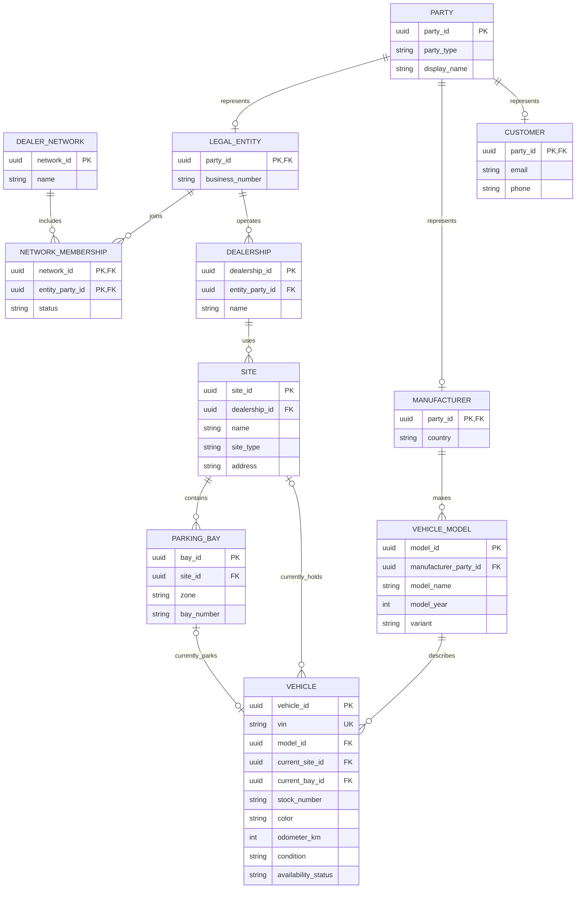
PARTY is a shared identity table for businesses and people. It lets an acquisition say “obtained from this party” whether that party is a manufacturer, another dealer, or a customer. A vehicle’s current_site_id and current_bay_id can be empty while it is in transit or after delivery.
2. Acquiring, preparing, transferring, and selling cars
This covers both new and used cars. For example, an acquisition can come from a manufacturer, another dealership, an auction supplier, or a customer trade-in.
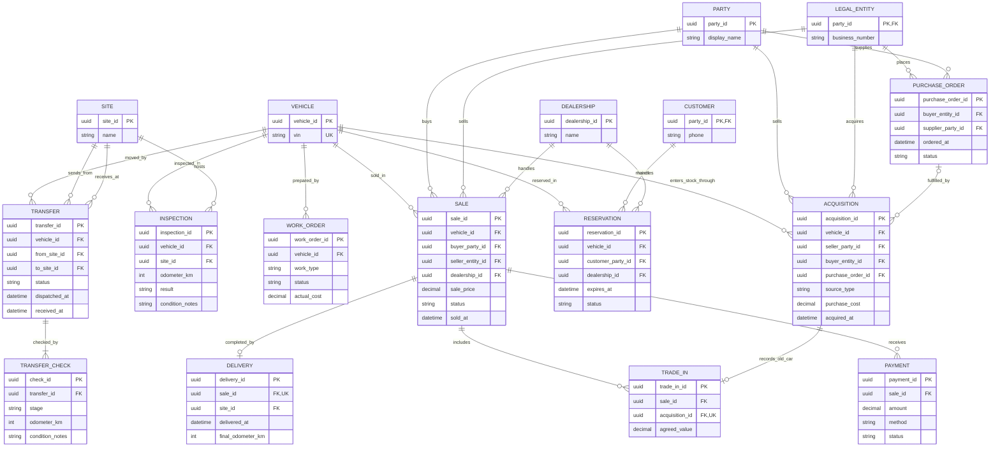
TRADE_IN links two transactions: the sale of the car the customer buys and the acquisition of the old car they give the dealership. A used car bought directly from a customer has an ACQUISITION without a TRADE_IN.
3. Ownership history, location history, staff access, and audit
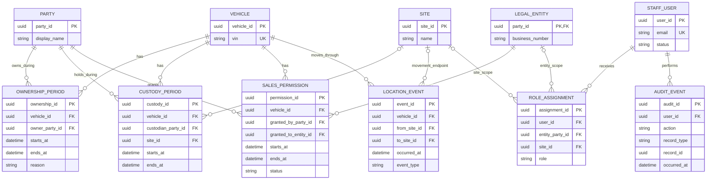
Important database rules
The ER diagram shows relationships; these extra rules should be enforced with database constraints and application transactions:
- A VIN is unique across the system.
- A vehicle has at most one current location, one current custodian, and one current owner.
- Ownership periods for the same vehicle cannot overlap.
- A vehicle cannot have two active reservations or two active sales at the same time.
- A parking bay can hold at most one vehicle if bays represent individual spaces.
- A vehicle’s current_bay_id must belong to its current_site_id.
- A transfer’s source and destination must differ.
- A ROLE_ASSIGNMENT should target one intended scope, such as an entity or site.
- Important changes to price, ownership, location, reservation, and sale status create audit events.
This is a logical database design, ready to turn into PostgreSQL tables after you decide the exact business rules—for example, whether independent dealerships may share listings and whether one sale can include multiple trade-ins.


6:23 PM


is this the perfect diagram as you suggested if no then correct and make it more strictly correct and if yes then give me the database schema for the database.


6:54 PM


Worked for 1m 17s


No—the previous ER diagram was a useful draft, but I would correct it before building tables. In particular, it did not model purchase-order lines, shared storage sites, or the relationship between a car’s site and parking bay tightly enough. It also left several “only one active record” rules unstated.
Here is a stricter logical database schema, shown as three ER views of the same database. It supports new cars, used-car purchases, trade-ins, multiple dealerships, shared sites, physical transfers, and separate ownership history. It deliberately leaves out country-specific registration rules.
1. Organizations, manufacturers, vehicles, and locations
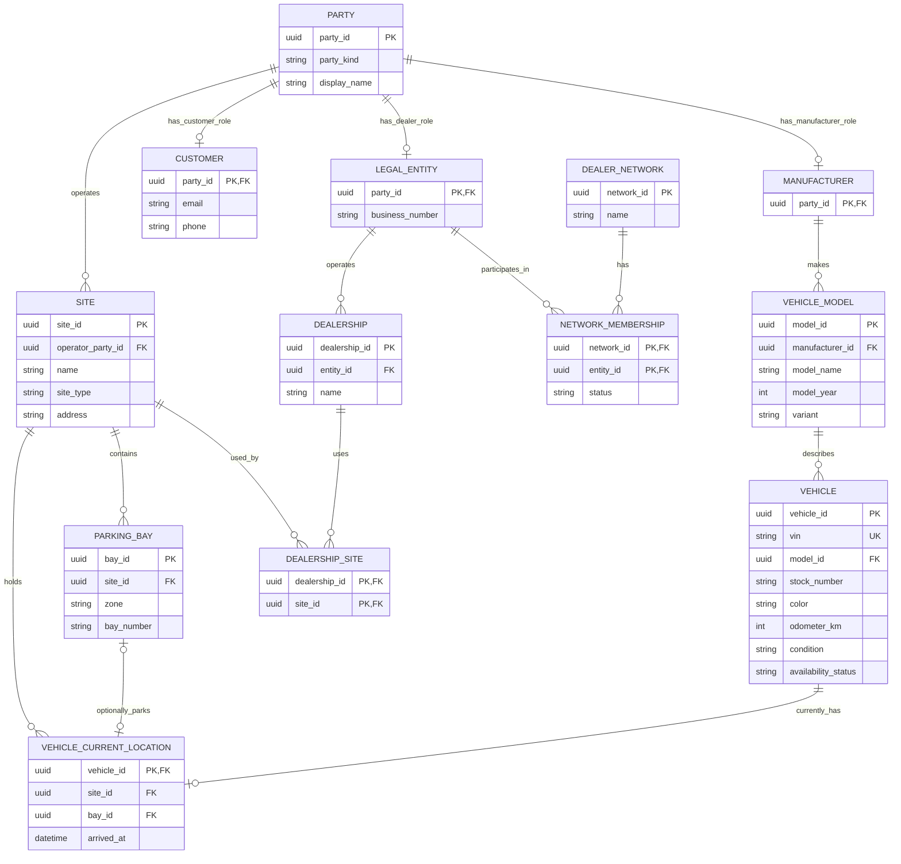
PARTY represents a person or organization. MANUFACTURER, LEGAL_ENTITY, and CUSTOMER are roles a party can have; they are not necessarily mutually exclusive. For example, another dealership can be the buyer in an interdealer sale.
DEALERSHIP_SITE allows two dealerships to use the same storage yard. VEHICLE_CURRENT_LOCATION has at most one row per VIN. While a car is in transit or after delivery, it may have no current-location row.
2. Inventory and commercial transactions
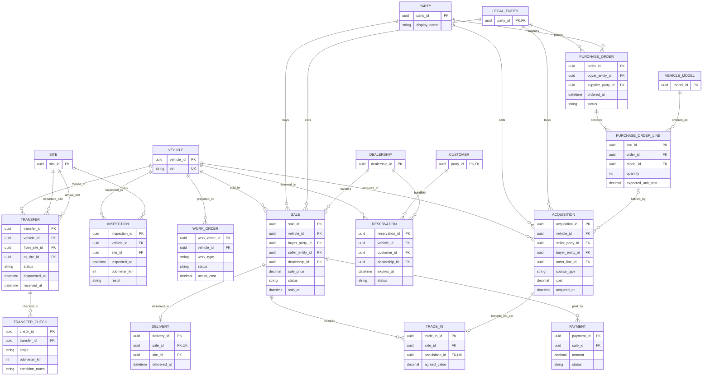
A manufacturer order specifies a model and quantity before the dealership necessarily knows each VIN. The ACQUISITION records each actual car received. For a used car bought from a customer, order_line_id can be empty. A trade-in links the sale of one car with the acquisition of the customer’s old car.
3. History, selling authority, and staff access
```mermaid
erDiagram
    VEHICLE {
        uuid vehicle_id PK
        string vin UK
    }
    PARTY {
        uuid party_id PK
    }
    LEGAL_ENTITY {
        uuid party_id PK, FK
    }
    DEALERSHIP {
        uuid dealership_id PK
    }
    SITE {
        uuid site_id PK
    }
    OWNERSHIP_PERIOD {
        uuid ownership_id PK
        uuid vehicle_id FK
        uuid owner_party_id FK
        datetime starts_at
        datetime ends_at
    }
    CUSTODY_PERIOD {
        uuid custody_id PK
        uuid vehicle_id FK
        uuid custodian_party_id FK
        datetime starts_at
        datetime ends_at
    }
    SALES_AUTHORIZATION {
        uuid authorization_id PK
        uuid vehicle_id FK
        uuid grantor_party_id FK
        uuid grantee_entity_id FK
        datetime starts_at
        datetime ends_at
        string status
    }
    LOCATION_EVENT {
        uuid event_id PK
        uuid vehicle_id FK
        uuid from_site_id FK
        uuid to_site_id FK
        datetime occurred_at
        string event_type
    }
    STAFF_USER {
        uuid user_id PK
        string email UK
    }
    ROLE {
        uuid role_id PK
        string role_name UK
    }
    ROLE_ASSIGNMENT {
        uuid assignment_id PK
        uuid user_id FK
        uuid role_id FK
        uuid entity_id FK
        uuid dealership_id FK
        uuid site_id FK
    }
    AUDIT_EVENT {
        uuid audit_id PK
        uuid actor_user_id FK
        string action
        string record_type
        uuid record_id
        datetime occurred_at
    }

    VEHICLE ||--o{ OWNERSHIP_PERIOD : has
    PARTY ||--o{ OWNERSHIP_PERIOD : owns_during
    VEHICLE ||--o{ CUSTODY_PERIOD : has
    PARTY ||--o{ CUSTODY_PERIOD : holds_during

    VEHICLE ||--o{ SALES_AUTHORIZATION : has
    PARTY ||--o{ SALES_AUTHORIZATION : grants
    LEGAL_ENTITY ||--o{ SALES_AUTHORIZATION : receives

    VEHICLE ||--o{ LOCATION_EVENT : has
    SITE |o--o{ LOCATION_EVENT : departure
    SITE |o--o{ LOCATION_EVENT : arrival

    STAFF_USER ||--o{ ROLE_ASSIGNMENT : receives
    ROLE ||--o{ ROLE_ASSIGNMENT : assigned_as
    LEGAL_ENTITY |o--o{ ROLE_ASSIGNMENT : entity_scope
    DEALERSHIP |o--o{ ROLE_ASSIGNMENT : dealership_scope
    SITE |o--o{ ROLE_ASSIGNMENT : site_scope
    STAFF_USER ||--o{ AUDIT_EVENT : performs
```
Rules the diagrams cannot enforce by themselves
These need explicit PostgreSQL constraints and transactional application logic:
- VEHICLE.vin is unique. A used car bought back later reuses its existing vehicle record.
- A bay belongs to the same site named in VEHICLE_CURRENT_LOCATION; a bay holds at most one car.
- A car has no overlapping ownership or custody periods. PostgreSQL range and exclusion constraints can enforce non-overlapping periods. PostgreSQL range types
- Only one reservation or sale may be active for a VIN at a time. Partial unique indexes are appropriate for such status-based uniqueness. PostgreSQL indexes
- A completed transfer needs a dispatch check and a receipt check; its source and destination must differ.
- A role assignment has exactly one intended scope: entity, dealership, or site.
- AUDIT_EVENT.record_type and record_id describe different kinds of records, so they are an audit reference rather than a conventional foreign key.
This is a more defensible ER design, but no diagram can be “perfect” before decisions such as shared-yard rules, consignment, and multi-car sales are fixed. The tables and keys above are a solid basis for PostgreSQL DDL; the listed constraints are part of that schema, not optional polish. PostgreSQL constraint reference


6:55 PM


give the database schema now


6:58 PM


Worked for 1m 15s


Below is an implementable PostgreSQL schema for the ER design. It supports multiple dealerships, manufacturers, new and used cars, shared storage sites, purchases, trade-ins, transfers, reservations, sales, and ownership history.
It assumes your application generates UUIDs. Run the blocks in order as reviewed database migrations.
1. Organizations, cars, and locations
CREATE TABLE party (
    party_id UUID PRIMARY KEY,
    party_kind TEXT NOT NULL
        CHECK (party_kind IN ('PERSON', 'ORGANIZATION')),
    display_name TEXT NOT NULL CHECK (length(trim(display_name)) > 0),
    UNIQUE (party_id, party_kind)
);

-- A party can have more than one business role.
CREATE TABLE manufacturer (
    party_id UUID PRIMARY KEY,
    party_kind TEXT NOT NULL DEFAULT 'ORGANIZATION'
        CHECK (party_kind = 'ORGANIZATION'),
    FOREIGN KEY (party_id, party_kind)
        REFERENCES party (party_id, party_kind)
);

CREATE TABLE legal_entity (
    party_id UUID PRIMARY KEY,
    party_kind TEXT NOT NULL DEFAULT 'ORGANIZATION'
        CHECK (party_kind = 'ORGANIZATION'),
    business_number TEXT,
    FOREIGN KEY (party_id, party_kind)
        REFERENCES party (party_id, party_kind)
);

CREATE TABLE customer (
    party_id UUID PRIMARY KEY REFERENCES party (party_id),
    email TEXT,
    phone TEXT
);

CREATE TABLE dealer_network (
    network_id UUID PRIMARY KEY,
    name TEXT NOT NULL
);

CREATE TABLE network_membership (
    network_id UUID NOT NULL REFERENCES dealer_network (network_id),
    entity_id UUID NOT NULL REFERENCES legal_entity (party_id),
    status TEXT NOT NULL CHECK (status IN ('ACTIVE', 'INACTIVE')),
    PRIMARY KEY (network_id, entity_id)
);

CREATE TABLE dealership (
    dealership_id UUID PRIMARY KEY,
    entity_id UUID NOT NULL REFERENCES legal_entity (party_id),
    name TEXT NOT NULL,
    UNIQUE (entity_id, dealership_id)
);

-- A site can be operated by a dealer or an outside storage business.
CREATE TABLE site (
    site_id UUID PRIMARY KEY,
    operator_party_id UUID NOT NULL REFERENCES party (party_id),
    name TEXT NOT NULL,
    site_type TEXT NOT NULL
        CHECK (site_type IN ('SHOWROOM', 'WAREHOUSE', 'YARD', 'WORKSHOP')),
    address TEXT
);

-- Several dealerships may use the same site.
CREATE TABLE dealership_site (
    dealership_id UUID NOT NULL REFERENCES dealership (dealership_id),
    site_id UUID NOT NULL REFERENCES site (site_id),
    PRIMARY KEY (dealership_id, site_id)
);

CREATE TABLE parking_bay (
    bay_id UUID PRIMARY KEY,
    site_id UUID NOT NULL REFERENCES site (site_id),
    zone TEXT NOT NULL,
    bay_number TEXT NOT NULL,
    UNIQUE (site_id, zone, bay_number),
    UNIQUE (site_id, bay_id)
);

CREATE TABLE vehicle_model (
    model_id UUID PRIMARY KEY,
    manufacturer_id UUID NOT NULL REFERENCES manufacturer (party_id),
    model_name TEXT NOT NULL,
    model_year INTEGER NOT NULL CHECK (model_year > 1885),
    variant TEXT NOT NULL DEFAULT '',
    UNIQUE (manufacturer_id, model_name, model_year, variant)
);

-- Keep the same vehicle_id if this VIN is sold and later bought back.
CREATE TABLE vehicle (
    vehicle_id UUID PRIMARY KEY,
    vin TEXT NOT NULL UNIQUE,
    model_id UUID NOT NULL REFERENCES vehicle_model (model_id),
    stock_number TEXT,
    color TEXT,
    odometer_km INTEGER NOT NULL DEFAULT 0 CHECK (odometer_km >= 0),
    current_stock_type TEXT
        CHECK (current_stock_type IN ('NEW', 'USED')),
    availability_status TEXT NOT NULL
        CHECK (availability_status IN
            ('EXPECTED', 'PREPARING', 'AVAILABLE',
             'RESERVED', 'BLOCKED', 'SOLD', 'DELIVERED')),
    asking_price NUMERIC(14, 2) CHECK (asking_price >= 0),
    currency_code CHAR(3)
);

-- A row exists only while the car is physically at a known site.
CREATE TABLE vehicle_current_location (
    vehicle_id UUID PRIMARY KEY REFERENCES vehicle (vehicle_id),
    site_id UUID NOT NULL REFERENCES site (site_id),
    bay_id UUID UNIQUE,
    arrived_at TIMESTAMPTZ NOT NULL,
    FOREIGN KEY (site_id, bay_id)
        REFERENCES parking_bay (site_id, bay_id)
);
The composite foreign key on (site_id, bay_id) prevents a vehicle from being assigned to a bay in a different site. bay_id is optional when staff know the yard but not the exact parking bay.
2. Staff and permissions
CREATE TABLE staff_user (
    user_id UUID PRIMARY KEY,
    email TEXT NOT NULL,
    display_name TEXT NOT NULL,
    status TEXT NOT NULL CHECK (status IN ('ACTIVE', 'DISABLED'))
);

CREATE UNIQUE INDEX staff_user_email_ci_uq
    ON staff_user (lower(email));

CREATE TABLE app_role (
    role_id UUID PRIMARY KEY,
    role_code TEXT NOT NULL UNIQUE
);

CREATE TABLE role_permission (
    role_id UUID NOT NULL REFERENCES app_role (role_id),
    permission_code TEXT NOT NULL,
    PRIMARY KEY (role_id, permission_code)
);

-- Exactly one scope is selected for each assignment.
CREATE TABLE role_assignment (
    assignment_id UUID PRIMARY KEY,
    user_id UUID NOT NULL REFERENCES staff_user (user_id),
    role_id UUID NOT NULL REFERENCES app_role (role_id),
    entity_id UUID REFERENCES legal_entity (party_id),
    dealership_id UUID REFERENCES dealership (dealership_id),
    site_id UUID REFERENCES site (site_id),
    starts_at TIMESTAMPTZ NOT NULL,
    ends_at TIMESTAMPTZ,
    CHECK (num_nonnulls(entity_id, dealership_id, site_id) = 1),
    CHECK (ends_at IS NULL OR ends_at > starts_at)
);
Example permissions are vehicle.view, vehicle.price.change, transfer.request, transfer.approve, and sale.complete.
3. Purchasing and preparing inventory
CREATE TABLE purchase_order (
    order_id UUID PRIMARY KEY,
    buyer_entity_id UUID NOT NULL REFERENCES legal_entity (party_id),
    supplier_party_id UUID NOT NULL REFERENCES party (party_id),
    ordered_at TIMESTAMPTZ NOT NULL,
    status TEXT NOT NULL
        CHECK (status IN ('DRAFT', 'PLACED', 'PART_RECEIVED',
                          'RECEIVED', 'CANCELLED'))
);

-- Orders specify models and quantities; VINs may be unknown when ordered.
CREATE TABLE purchase_order_line (
    line_id UUID PRIMARY KEY,
    order_id UUID NOT NULL REFERENCES purchase_order (order_id),
    model_id UUID NOT NULL REFERENCES vehicle_model (model_id),
    quantity INTEGER NOT NULL CHECK (quantity > 0),
    expected_unit_cost NUMERIC(14, 2)
        CHECK (expected_unit_cost >= 0)
);

-- There may be several acquisitions for one VIN over its lifetime.
CREATE TABLE acquisition (
    acquisition_id UUID PRIMARY KEY,
    vehicle_id UUID NOT NULL REFERENCES vehicle (vehicle_id),
    seller_party_id UUID NOT NULL REFERENCES party (party_id),
    buyer_entity_id UUID NOT NULL REFERENCES legal_entity (party_id),
    order_line_id UUID REFERENCES purchase_order_line (line_id),
    source_type TEXT NOT NULL
        CHECK (source_type IN
            ('NEW_STOCK', 'USED_PURCHASE', 'TRADE_IN',
             'AUCTION', 'INTERDEALER')),
    stock_type TEXT NOT NULL CHECK (stock_type IN ('NEW', 'USED')),
    cost NUMERIC(14, 2) NOT NULL CHECK (cost >= 0),
    currency_code CHAR(3) NOT NULL,
    acquired_at TIMESTAMPTZ NOT NULL
);

CREATE TABLE inspection (
    inspection_id UUID PRIMARY KEY,
    vehicle_id UUID NOT NULL REFERENCES vehicle (vehicle_id),
    site_id UUID NOT NULL REFERENCES site (site_id),
    inspected_at TIMESTAMPTZ NOT NULL,
    odometer_km INTEGER NOT NULL CHECK (odometer_km >= 0),
    result TEXT NOT NULL CHECK (result IN ('PASS', 'FAIL', 'REVIEW')),
    condition_notes TEXT
);

CREATE TABLE work_order (
    work_order_id UUID PRIMARY KEY,
    vehicle_id UUID NOT NULL REFERENCES vehicle (vehicle_id),
    site_id UUID REFERENCES site (site_id),
    work_type TEXT NOT NULL,
    status TEXT NOT NULL
        CHECK (status IN ('OPEN', 'IN_PROGRESS', 'DONE', 'CANCELLED')),
    actual_cost NUMERIC(14, 2) CHECK (actual_cost >= 0)
);
A direct used-car purchase has no order_line_id. A trade-in is linked to its related customer sale below.
4. Transfers and location history
CREATE TABLE transfer (
    transfer_id UUID PRIMARY KEY,
    vehicle_id UUID NOT NULL REFERENCES vehicle (vehicle_id),
    from_site_id UUID NOT NULL REFERENCES site (site_id),
    to_site_id UUID NOT NULL REFERENCES site (site_id),
    status TEXT NOT NULL
        CHECK (status IN
            ('REQUESTED', 'APPROVED', 'IN_TRANSIT',
             'RECEIVED', 'CANCELLED', 'DISCREPANCY')),
    requested_at TIMESTAMPTZ NOT NULL,
    dispatched_at TIMESTAMPTZ,
    received_at TIMESTAMPTZ,
    CHECK (from_site_id <> to_site_id),
    CHECK (
        received_at IS NULL OR
        (dispatched_at IS NOT NULL AND received_at >= dispatched_at)
    )
);

CREATE TABLE transfer_check (
    check_id UUID PRIMARY KEY,
    transfer_id UUID NOT NULL REFERENCES transfer (transfer_id),
    stage TEXT NOT NULL CHECK (stage IN ('DISPATCH', 'RECEIPT')),
    checked_at TIMESTAMPTZ NOT NULL,
    odometer_km INTEGER NOT NULL CHECK (odometer_km >= 0),
    condition_notes TEXT,
    UNIQUE (transfer_id, stage)
);

CREATE TABLE location_event (
    event_id UUID PRIMARY KEY,
    vehicle_id UUID NOT NULL REFERENCES vehicle (vehicle_id),
    transfer_id UUID REFERENCES transfer (transfer_id),
    from_site_id UUID REFERENCES site (site_id),
    from_bay_id UUID,
    to_site_id UUID REFERENCES site (site_id),
    to_bay_id UUID,
    event_type TEXT NOT NULL,
    occurred_at TIMESTAMPTZ NOT NULL,
    actor_user_id UUID REFERENCES staff_user (user_id),
    CHECK (from_site_id IS NOT NULL OR to_site_id IS NOT NULL),
    CHECK (from_bay_id IS NULL OR from_site_id IS NOT NULL),
    CHECK (to_bay_id IS NULL OR to_site_id IS NOT NULL),
    FOREIGN KEY (from_site_id, from_bay_id)
        REFERENCES parking_bay (site_id, bay_id),
    FOREIGN KEY (to_site_id, to_bay_id)
        REFERENCES parking_bay (site_id, bay_id)
);

CREATE UNIQUE INDEX one_active_transfer_per_vehicle
    ON transfer (vehicle_id)
    WHERE status IN ('REQUESTED', 'APPROVED', 'IN_TRANSIT',
                     'DISCREPANCY');
When staff dispatch a car, update the transfer, remove its vehicle_current_location row, and append a location_event in one database transaction. At receipt, insert the new current location and receipt event in one transaction.
5. Reservations, listings, sales, and trade-ins
CREATE TABLE reservation (
    reservation_id UUID PRIMARY KEY,
    vehicle_id UUID NOT NULL REFERENCES vehicle (vehicle_id),
    customer_id UUID NOT NULL REFERENCES customer (party_id),
    dealership_id UUID NOT NULL REFERENCES dealership (dealership_id),
    created_at TIMESTAMPTZ NOT NULL,
    expires_at TIMESTAMPTZ NOT NULL,
    status TEXT NOT NULL
        CHECK (status IN ('ACTIVE', 'EXPIRED', 'CANCELLED',
                          'CONVERTED')),
    CHECK (expires_at > created_at)
);

CREATE UNIQUE INDEX one_active_reservation_per_vehicle
    ON reservation (vehicle_id)
    WHERE status = 'ACTIVE';

CREATE TABLE vehicle_listing (
    listing_id UUID PRIMARY KEY,
    vehicle_id UUID NOT NULL REFERENCES vehicle (vehicle_id),
    seller_entity_id UUID NOT NULL REFERENCES legal_entity (party_id),
    dealership_id UUID NOT NULL,
    asking_price NUMERIC(14, 2) NOT NULL CHECK (asking_price >= 0),
    currency_code CHAR(3) NOT NULL,
    status TEXT NOT NULL
        CHECK (status IN ('DRAFT', 'ACTIVE', 'WITHDRAWN', 'SOLD')),
    FOREIGN KEY (seller_entity_id, dealership_id)
        REFERENCES dealership (entity_id, dealership_id)
);

CREATE UNIQUE INDEX one_active_listing_per_dealership
    ON vehicle_listing (vehicle_id, dealership_id)
    WHERE status = 'ACTIVE';

CREATE TABLE sale (
    sale_id UUID PRIMARY KEY,
    vehicle_id UUID NOT NULL REFERENCES vehicle (vehicle_id),
    buyer_party_id UUID NOT NULL REFERENCES party (party_id),
    seller_entity_id UUID NOT NULL REFERENCES legal_entity (party_id),
    dealership_id UUID NOT NULL,
    sale_price NUMERIC(14, 2) NOT NULL CHECK (sale_price >= 0),
    currency_code CHAR(3) NOT NULL,
    status TEXT NOT NULL
        CHECK (status IN ('DRAFT', 'CONTRACTED', 'COMPLETED',
                          'CANCELLED')),
    sold_at TIMESTAMPTZ,
    FOREIGN KEY (seller_entity_id, dealership_id)
        REFERENCES dealership (entity_id, dealership_id),
    CHECK (status <> 'COMPLETED' OR sold_at IS NOT NULL)
);

CREATE UNIQUE INDEX one_open_sale_per_vehicle
    ON sale (vehicle_id)
    WHERE status IN ('DRAFT', 'CONTRACTED');

CREATE TABLE payment (
    payment_id UUID PRIMARY KEY,
    sale_id UUID NOT NULL REFERENCES sale (sale_id),
    payment_kind TEXT NOT NULL
        CHECK (payment_kind IN ('CHARGE', 'REFUND')),
    amount NUMERIC(14, 2) NOT NULL CHECK (amount > 0),
    currency_code CHAR(3) NOT NULL,
    method TEXT NOT NULL,
    status TEXT NOT NULL
        CHECK (status IN ('PENDING', 'SETTLED', 'FAILED')),
    recorded_at TIMESTAMPTZ NOT NULL
);

CREATE TABLE delivery (
    delivery_id UUID PRIMARY KEY,
    sale_id UUID NOT NULL UNIQUE REFERENCES sale (sale_id),
    site_id UUID NOT NULL REFERENCES site (site_id),
    delivered_at TIMESTAMPTZ NOT NULL,
    final_odometer_km INTEGER NOT NULL CHECK (final_odometer_km >= 0)
);

-- The acquisition is the customer's old car;
-- the sale is the car the customer buys.
CREATE TABLE trade_in (
    trade_in_id UUID PRIMARY KEY,
    sale_id UUID NOT NULL REFERENCES sale (sale_id),
    acquisition_id UUID NOT NULL UNIQUE
        REFERENCES acquisition (acquisition_id),
    agreed_value NUMERIC(14, 2) NOT NULL CHECK (agreed_value >= 0)
);
The active-reservation index depends on the stored status. A background task or request handler must mark expired reservations EXPIRED; an index condition based directly on the current time would not be appropriate. PostgreSQL partial unique indexes enforce uniqueness for rows matching a stable condition such as status = 'ACTIVE'. PostgreSQL index documentation
6. Ownership, custody, selling authority, and audit
-- Required for exclusion constraints comparing UUIDs in GiST.
CREATE EXTENSION IF NOT EXISTS btree_gist;

CREATE TABLE ownership_period (
    ownership_id UUID PRIMARY KEY,
    vehicle_id UUID NOT NULL REFERENCES vehicle (vehicle_id),
    owner_party_id UUID NOT NULL REFERENCES party (party_id),
    starts_at TIMESTAMPTZ NOT NULL,
    ends_at TIMESTAMPTZ,
    reason TEXT NOT NULL,
    CHECK (ends_at IS NULL OR ends_at > starts_at),
    EXCLUDE USING gist (
        vehicle_id WITH =,
        tstzrange(
            starts_at,
            COALESCE(ends_at, 'infinity'::timestamptz),
            '[)'
        ) WITH &&
    )
);

CREATE TABLE custody_period (
    custody_id UUID PRIMARY KEY,
    vehicle_id UUID NOT NULL REFERENCES vehicle (vehicle_id),
    custodian_party_id UUID NOT NULL REFERENCES party (party_id),
    starts_at TIMESTAMPTZ NOT NULL,
    ends_at TIMESTAMPTZ,
    CHECK (ends_at IS NULL OR ends_at > starts_at),
    EXCLUDE USING gist (
        vehicle_id WITH =,
        tstzrange(
            starts_at,
            COALESCE(ends_at, 'infinity'::timestamptz),
            '[)'
        ) WITH &&
    )
);

-- Used when an entity may sell a vehicle it does not own.
CREATE TABLE sales_authorization (
    authorization_id UUID PRIMARY KEY,
    vehicle_id UUID NOT NULL REFERENCES vehicle (vehicle_id),
    grantor_party_id UUID NOT NULL REFERENCES party (party_id),
    grantee_entity_id UUID NOT NULL REFERENCES legal_entity (party_id),
    starts_at TIMESTAMPTZ NOT NULL,
    ends_at TIMESTAMPTZ,
    status TEXT NOT NULL
        CHECK (status IN ('ACTIVE', 'REVOKED', 'EXPIRED')),
    CHECK (ends_at IS NULL OR ends_at > starts_at)
);

CREATE TABLE audit_event (
    audit_id UUID PRIMARY KEY,
    actor_user_id UUID REFERENCES staff_user (user_id),
    action TEXT NOT NULL,
    record_type TEXT NOT NULL,
    record_id UUID NOT NULL,
    reason TEXT,
    details JSONB,
    occurred_at TIMESTAMPTZ NOT NULL DEFAULT now()
);

CREATE INDEX ownership_period_vehicle_idx
    ON ownership_period (vehicle_id, starts_at DESC);

CREATE INDEX location_event_vehicle_idx
    ON location_event (vehicle_id, occurred_at DESC);

CREATE INDEX acquisition_vehicle_idx
    ON acquisition (vehicle_id, acquired_at DESC);

CREATE INDEX sale_vehicle_idx
    ON sale (vehicle_id, sold_at DESC);
The exclusion constraints prevent two ownership periods—or two custody periods—for the same car from overlapping. PostgreSQL range and exclusion constraints
Rules to implement in application transactions
SQL constraints cover a lot, but several rules involve checking multiple tables:
- The VIN and model received for an acquisition must match its purchase-order line.
- A completed transfer must have both DISPATCH and RECEIPT checks.
- The seller in a sale must currently own the car or have valid selling authorization.
- Completing an acquisition or sale must update ownership history and relevant vehicle status together.
- A trade-in’s acquisition seller should match the buyer on the linked sale.
- A listing must be visible only to dealerships allowed to offer that vehicle.
- Changes to current location must append a matching location event.
Use one PostgreSQL transaction for each of those business operations. PostgreSQL cautions that ordinary CHECK constraints cannot safely verify other table rows, so these cross-table rules need carefully designed transaction logic or database triggers. PostgreSQL constraint documentation
This schema is a strong starting migration, though I have not executed it against a PostgreSQL instance here. Before production, the next step is to apply it to a clean test database and write concurrency tests for reservations, transfers, acquisitions, and sales.


6:59 PM


can you give me the complete ER diagram and the UML diagrams information properly and exactly  in a foramt that i can provide to an LLM.
as the part of the plan information detailed providing the it the information to what to build and how to build with my specification and features as decided.


8:54 PM


Worked for 1m 21s


Below is a self-contained Markdown specification you can copy into another LLM. It consolidates the decisions from our conversation and corrects inconsistencies in the earlier drafts. The diagrams are design views of one system; an entity repeated across diagrams represents the same entity.
Car Dealership Inventory System — Build Specification
1. Objective and scope
Build a production-oriented inventory application for a network of car dealerships. It must track each physical car by its unique VIN and support:
- Multiple legal dealership businesses in one application.
- Multiple branches, showrooms, warehouses, yards, and workshops.
- Manufacturers, vehicle models, and individual vehicles.
- New and used car acquisition, including direct purchases and trade-ins.
- Inspections and preparation work.
- Exact current location and historical movements.
- Transfers between sites, including sites used by different dealerships.
- Separate records for physical location, custody, ownership, and permission to sell.
- Listings, reservations, sales, payments, and delivery.
- Scoped staff permissions and an audit trail.
- Automated tests, deployment, backups, and monitoring.
Inventory unit: one Vehicle record represents one physical car and one VIN. This is not a quantity-based parts inventory system.
Initial-release exclusions: government registration automation, tax calculation, accounting ledger, financing-provider integrations, and offline scanner synchronization. Keep extension points for these features.
2. Decisions and terminology
Term	Meaning
DealerNetwork	A shared application workspace connecting participating legal entities. Membership alone does not grant access to private data.
LegalEntity	A business that can buy, own, or sell a vehicle.
Dealership	A branch or outlet operated by one legal entity.
Site	A physical showroom, warehouse, yard, or workshop. Several dealerships may use one site.
ParkingBay	An optional exact position within a site. One bay holds at most one car at a time.
Manufacturer	The maker of a vehicle model. The party supplying a specific car may be someone else.
VehicleModel	Make/model/year/variant specification shared by many cars.
Vehicle	One physical car, identified by a globally unique VIN.
Acquisition	A transaction through which a legal entity obtains a car. A VIN may have several acquisitions over its lifetime if bought back.
Transfer	Movement between sites. It does not inherently change ownership.
OwnershipPeriod	Who owned the car during a time interval.
CustodyPeriod	Who had physical responsibility for it during a time interval.
SalesAuthorization	Permission for a legal entity to offer a car it does not own.
Party	A person or organization that can be a buyer, seller, owner, supplier, or custodian.


Assume reliable connectivity for the first release. Store timestamps as UTC-capable timestamptz; display local time in the UI. Store monetary amounts as decimal values with a currency code.
3. Chosen architecture and stack
Layer	Choice	Purpose
Architecture	Modular monolith plus worker	Separate business modules in one deployable API; process background work separately.
Backend	TypeScript, Node.js LTS, NestJS	APIs, validation, permissions, and business workflows.
API	REST/JSON with OpenAPI	Documented contract for the web app and integrations.
Database	PostgreSQL	Transactional system of record.
Database access	Drizzle ORM and reviewed SQL migrations	Typed queries with SQL control for constraints and transactions.
Authentication	Amazon Cognito using OIDC	Staff sign-in and account management.
Authorization	Application roles scoped to entity, dealership, or site	Control who may view or change each record.
Frontend	React, TypeScript, Vite	Staff application.
Frontend libraries	TanStack Query, React Hook Form, Zod, MUI	Data fetching, forms, validation, and UI components.
Files	Amazon S3	Vehicle photos and supporting documents.
Background work	Amazon SQS and a NestJS worker	Notifications, imports, exports, and retries.
Local environment	Docker Compose	API, worker, and PostgreSQL.
Deployment	Docker, AWS ECS Fargate, RDS PostgreSQL	Container hosting and managed database.
Infrastructure	AWS CDK	Versioned infrastructure configuration.
CI/CD	GitHub Actions	Checks, tests, builds, migrations, deployments.
Monitoring	Structured logs, CloudWatch, OpenTelemetry	Errors, performance, and alerts.


Use transaction boundaries for acquisitions, dispatch, receipt, reservation, sale completion, and ownership changes. Drizzle supports database transactions; PostgreSQL constraints should enforce rules that can be expressed in the database. Drizzle transactions, PostgreSQL constraints
Part A — UML diagrams
A1. Core structure — class diagram
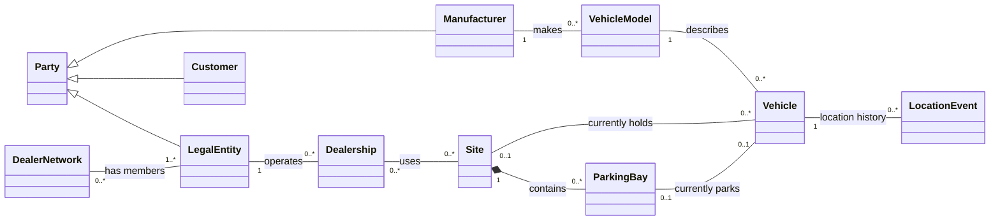
Party is a conceptual parent here. In the database, manufacturer, legal entity, and customer are roles attached to a party; a business can have multiple roles.
A2. Rights and responsibility — class diagram
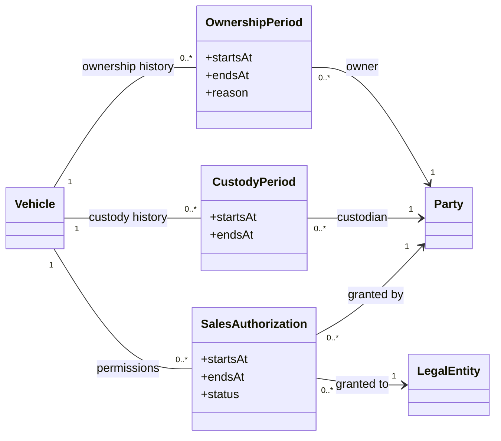
Location, custody, ownership, and authority to sell are independent. Do not change ownership merely because a transfer is received.
A3. Operational lifecycle — class diagram
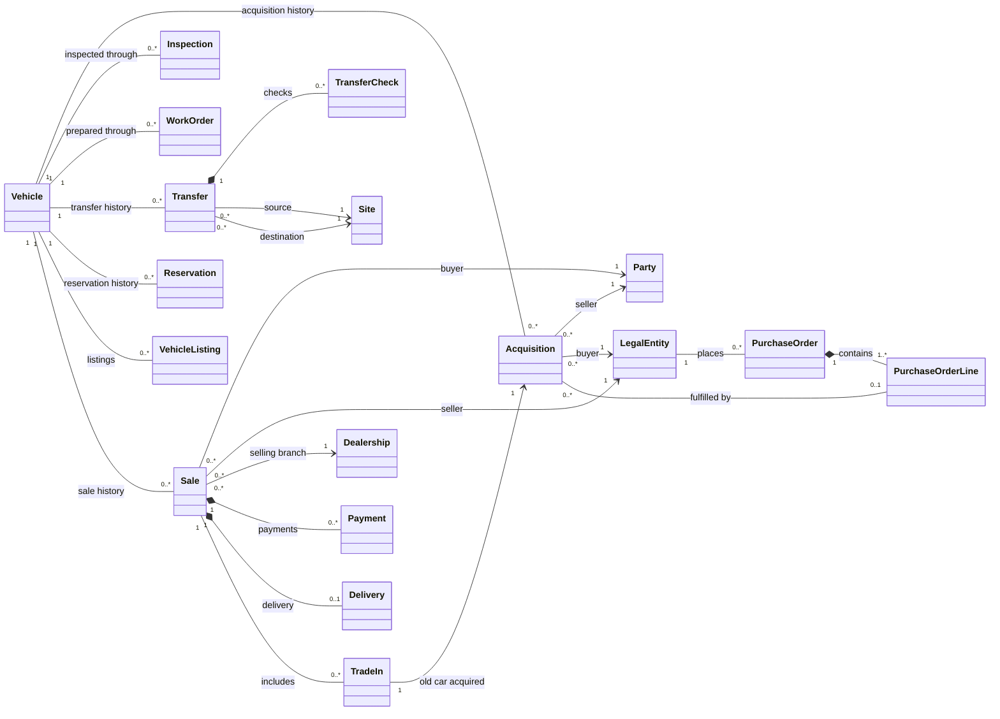
A4. Staff access — class diagram
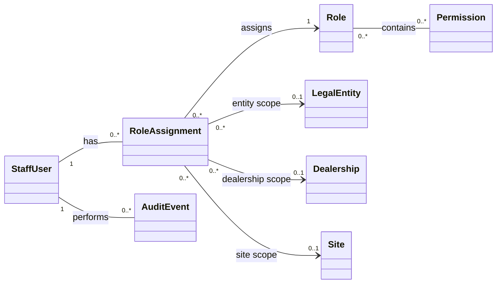
Each role assignment has exactly one of those three scopes.
A5. Vehicle availability — state diagram
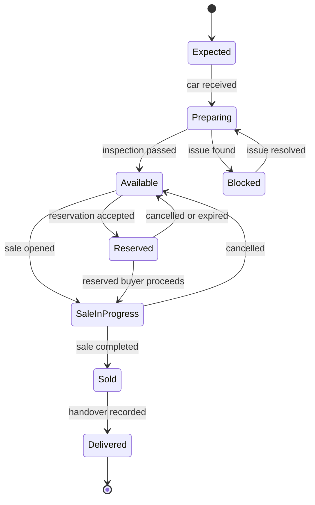
A6. Physical transfer — state diagram
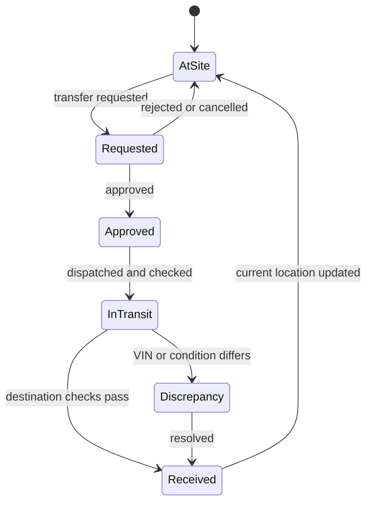
The availability and transfer states are separate. A reserved car can be in transit.
A7. Transfer workflow — sequence diagram
```mermaid
sequenceDiagram
    actor Requester
    actor Manager
    actor SourceStaff
    actor DestinationStaff
    participant API
    participant DB as PostgreSQL

    Requester->>API: Request transfer for VIN
    API->>DB: Check car, location, permissions, conflicts
    API->>DB: Create REQUESTED transfer
    Manager->>API: Approve transfer
    API->>DB: Set APPROVED
    SourceStaff->>API: Record dispatch VIN, mileage, condition
    API->>DB: Transaction: add dispatch check and event; remove current location; set IN_TRANSIT
    DestinationStaff->>API: Record receipt VIN, mileage, condition
    alt Details accepted
        API->>DB: Transaction: add receipt check and event; set current location; set RECEIVED
    else Discrepancy
        API->>DB: Record discrepancy; keep transfer unresolved
    end
```
A8. Used-car trade-in workflow — sequence diagram
```mermaid
sequenceDiagram
    actor Customer
    actor SalesStaff
    participant API
    participant DB as PostgreSQL

    Customer->>SalesStaff: Offers old car toward another car
    SalesStaff->>API: Enter old VIN and inspect condition
    API->>DB: Find or create Vehicle for old VIN
    SalesStaff->>API: Record valuation and proposed deal
    API->>DB: Create draft Sale for purchased car
    API->>DB: Create Acquisition for old car
    API->>DB: Link Sale and Acquisition with TradeIn
    SalesStaff->>API: Complete deal
    API->>DB: Transaction: validate authority and conflicts; complete sale; update ownership histories
```
Part B — Relational ER diagrams
The following three diagrams are one database split into readable views. Table names and keys are canonical. PK = primary key, FK = foreign key, UK = unique key. Mermaid supports these ER key annotations. Mermaid ER syntax
B1. Master data and current location
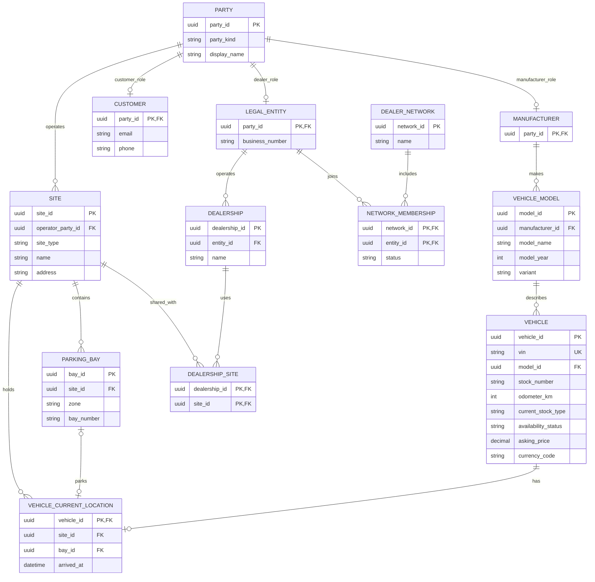
B2. Purchases, operations, listings, and sales
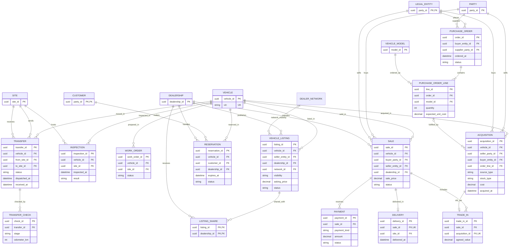
VEHICLE_LISTING.visibility is PRIVATE, NETWORK, or SELECTED. A NETWORK listing has a network_id; a SELECTED listing uses LISTING_SHARE. Network membership does not expose private listings.
B3. History, authority, access, and audit


erDiagram
    VEHICLE {
        uuid vehicle_id PK
    }
    PARTY {
        uuid party_id PK
    }
    LEGAL_ENTITY {
        uuid party_id PK, FK
    }
    DEALERSHIP {
        uuid dealership_id PK
    }
    SITE {
        uuid site_id PK
    }
    OWNERSHIP_PERIOD {
        uuid ownership_id PK
        uuid vehicle_id FK
        uuid owner_party_id FK
        datetime starts_at
        datetime ends_at
    }
    CUSTODY_PERIOD {
        uuid custody_id PK
        uuid vehicle_id FK
        uuid custodian_party_id FK
        datetime starts_at
        datetime ends_at
    }
    SALES_AUTHORIZATION {
        uuid authorization_id PK
        uuid vehicle_id FK
        uuid grantor_party_id FK
        uuid grantee_entity_id FK
        datetime starts_at
        datetime ends_at
        string status
    }
    LOCATION_EVENT {
        uuid event_id PK
        uuid vehicle_id FK
        uuid transfer_id FK
        uuid from_site_id FK
        uuid to_site_id FK
        datetime occurred_at
    }
    STAFF_USER {
        uuid user_id PK
        string email UK
        string status
    }
    APP_ROLE {
        uuid role_id PK
        string role_code UK
    }
    ROLE_PERMISSION {
        uuid role_id PK, FK
        string permission_code PK
    }
    ROLE_ASSIGNMENT {
        uuid assignment_id PK
        uuid user_id FK
        uuid role_id FK
        uuid entity_id FK
        uuid dealership_id FK
        uuid site_id FK
    }
    AUDIT_EVENT {
        uuid audit_id PK
        uuid actor_user_id FK
        string action
        string record_type
        uuid record_id
        datetime occurred_at
    }
    OUTBOX_EVENT {
        uuid outbox_id PK
        string event_type
        jsonb payload
        datetime created_at
        datetime published_at
    }

    VEHICLE ||--o{ OWNERSHIP_PERIOD : has
    PARTY ||--o{ OWNERSHIP_PERIOD : owns
    VEHICLE ||--o{ CUSTODY_PERIOD : has
    PARTY ||--o{ CUSTODY_PERIOD : holds
    VEHICLE ||--o{ SALES_AUTHORIZATION : has
    PARTY ||--o{ SALES_AUTHORIZATION : grants
    LEGAL_ENTITY ||--o{ SALES_AUTHORIZATION : receives
    VEHICLE ||--o{ LOCATION_EVENT : moves_through
    SITE |o--o{ LOCATION_EVENT : departure
    SITE |o--o{ LOCATION_EVENT : arrival
    STAFF_USER ||--o{ ROLE_ASSIGNMENT : receives
    APP_ROLE ||--o{ ROLE_ASSIGNMENT : assigned_as
    APP_ROLE ||--o{ ROLE_PERMISSION : contains
    LEGAL_ENTITY |o--o{ ROLE_ASSIGNMENT : entity_scope
    DEALERSHIP |o--o{ ROLE_ASSIGNMENT : dealership_scope
    SITE |o--o{ ROLE_ASSIGNMENT : site_scope
    STAFF_USER ||--o{ AUDIT_EVENT : performs


4. Required database constraints
Implement these in PostgreSQL migrations, even where Mermaid cannot show them:
1. VEHICLE.vin is globally unique and immutable after verified intake, except through a controlled correction workflow.
2. PARKING_BAY(site_id, zone, bay_number) is unique.
3. VEHICLE_CURRENT_LOCATION.vehicle_id is unique. Its bay_id, when present, is unique and must reference a bay belonging to its site_id.
4. A car has no overlapping OWNERSHIP_PERIOD records and no overlapping CUSTODY_PERIOD records. Use range/exclusion constraints or an equivalent enforced design.
5. At most one active reservation, one open sale, and one active transfer exist for a VIN. Use partial unique indexes over the relevant stored statuses.
6. TRANSFER.from_site_id <> TRANSFER.to_site_id.
7. A received transfer has both dispatch and receipt checks, in the correct order.
8. A SALE dealership belongs to its seller legal entity. Enforce with a composite foreign key.
9. An ACQUISITION linked to a purchase-order line must match the ordered model, supplier, and buying entity; enforce in transactional logic or a trigger.
10. A TRADE_IN acquisition belongs to at most one trade-in and represents the old car, not the sold car.
11. A ROLE_ASSIGNMENT has exactly one scope: entity, dealership, or site.
12. Do not derive an active-reservation index from now(). Update expired reservations to EXPIRED, then use a partial unique index on status = 'ACTIVE'.
13. Preserve historical transaction rows. Use reversal or cancellation records instead of silently deleting completed business events.
PostgreSQL supports partial unique indexes and exclusion constraints for several of these rules. PostgreSQL indexes, range constraints
5. Required business workflows
New car intake
1. Create manufacturer and model.
2. Place a purchase order containing model and quantity lines.
3. Receive each physical car with its VIN.
4. Match the acquisition against the purchase-order line.
5. Record ownership, custody, location, inspection, and any preparation work.
6. Mark the car AVAILABLE only after required checks pass.
Used car purchase
1. Search by VIN before creating a vehicle. Reuse an existing historical record if found.
2. Record seller, mileage, inspection, valuation, purchase cost, and buying legal entity.
3. Create a new acquisition and ownership period.
4. Receive into a site; record custody and location.
5. Complete any preparation work before listing.
Trade-in
1. Create a sale for the car the customer is buying.
2. Inspect and value the customer’s old car.
3. Create an acquisition for that old car.
4. Link sale and acquisition through TRADE_IN.
5. Complete the deal atomically where its dependent changes must succeed together.
Site transfer
1. Request and authorize transfer of a specific VIN.
2. Check that no conflicting transfer exists.
3. Record dispatch check; move to IN_TRANSIT; remove current-location row.
4. Record destination receipt check.
5. On acceptance, insert the new current-location row and location event.
6. On mismatch or damage, keep a discrepancy open for resolution.
7. Do not change ownership merely because the car moved.
Reservation and sale
1. Check current availability and permissions.
2. Create one active reservation for the VIN.
3. Expire or cancel it explicitly, or convert it into a sale.
4. Confirm that the selling entity owns the vehicle or has current selling authorization.
5. Record buyer, selling dealership, price, payment records, and delivery.
6. Complete the sale and ownership changes in a transaction; withdraw active listings.
6. Minimum API modules and endpoints
Define exact request/response schemas in OpenAPI. Start with these resource groups:
Module	Minimum operations
Manufacturers/models	Create, list, update, search.
Parties/customers	Create, search, view history.
Network/dealerships/sites	Manage membership, branches, sites, and bays.
Vehicles	Create/intake, get by VIN, search/filter, history, current location.
Purchase orders	Create, add lines, place, receive against line.
Acquisitions	Record new/used purchase and trade-in acquisition.
Inspections/work orders	Create, update, complete, view by VIN.
Transfers	Request, approve, dispatch, receive, resolve discrepancy.
Listings	Publish, withdraw, share with network or selected dealers.
Reservations	Create, expire, cancel, convert.
Sales/payments/deliveries	Draft, contract, complete, record payment/refund, deliver.
Access/audit	Assign roles, check permissions, query audit history.


Use pagination, filtering, and stable sorting on lists. Require an idempotency key for operations likely to be retried, especially receiving, dispatch, payment recording, and sale completion.
7. Frontend screens
Build at least:
- Network dashboard with permitted inventory totals and aging.
- Vehicle search by VIN, model, site, dealership, status, and new/used classification.
- Vehicle detail with current location, ownership, inspection, movement, reservation, and sale history.
- Manufacturer/model management.
- Purchase orders and receiving.
- Used-car intake and inspection.
- Transfer request, dispatch, receipt, and discrepancy screens.
- Site map or bay list.
- Listing and sharing controls.
- Customer reservation and sale workflow.
- Trade-in valuation and linkage.
- Staff role management and audit viewer.
Show users the distinction between physical site, owning entity, and selling dealership on the vehicle detail screen.
8. Testing and acceptance criteria
Use Vitest for business logic, PostgreSQL Testcontainers for database integration tests, Supertest for API tests, Playwright for browser workflows, and k6 for load testing. NestJS supports the unit and integration testing structure; Playwright supports browser end-to-end tests. NestJS testing, Playwright testing
The release must pass at least these cases:
- Two staff members cannot reserve the same VIN concurrently.
- Two transfers cannot be active for the same VIN.
- A dispatch removes the source current location; a failed receipt does not invent a destination location.
- A received transfer records dispatch and receipt checks.
- Moving a car between warehouses does not change its owner.
- A dealer cannot sell another entity’s car without ownership or valid authorization.
- A used car sold and bought back retains the same VIN and vehicle ID, with separate acquisition and sale histories.
- A trade-in links the correct old-car acquisition and new-car sale.
- A user scoped to one site cannot modify another site’s records.
- A network listing is visible to permitted members; a private listing is not.
- A duplicate request with the same idempotency key does not create a second acquisition, transfer, payment, or sale.
- Backups can be restored to a test environment, and the restored inventory history is readable.
9. Implementation order
1. Set up repository, modules, database migrations, authentication, CI, and local Docker environment.
2. Implement parties, manufacturers, models, legal entities, dealerships, sites, and bays.
3. Implement vehicle identity, location events, current location, ownership and custody history.
4. Implement new/used acquisition, purchase orders, inspections, and work orders.
5. Implement transfers with transaction boundaries and concurrency tests.
6. Implement listings, sharing, reservations, and sales.
7. Implement trade-ins, payments, delivery, and reporting.
8. Add audit, outbox/worker, operational monitoring, backup restore testing, performance testing, and deployment gates.
